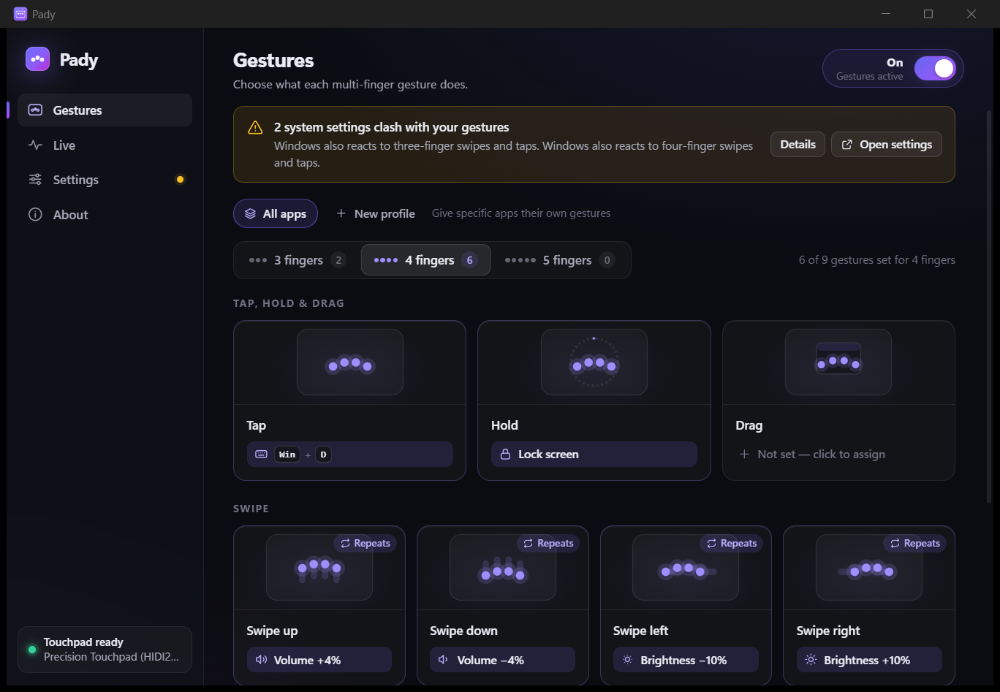

<p align="center">
  
</p>

<h1 align="center">Pady</h1>

<p align="center">
  <b>Your touchpad, your shortcuts.</b><br>
  Map three-, four- and five-finger taps, holds, swipes and drags to anything on Windows and Linux.
</p>

<p align="center">
  
</p>

---

## What it does

| Gesture | Example action |
|---|---|
| **3-finger drag** | Drag windows and select text without holding the button (the macOS feature Windows never got) |
| **4-finger swipe up / down** | *Scrub* the volume: keep sliding and it keeps stepping |
| **4-finger swipe left / right** | Dim or brighten the screen, also scrubbable |
| **3-finger tap** | Play / pause |
| **4-finger tap** | Open Chrome at a specific link, or bring an app to the front |
| **4-finger hold** | Lock the screen |

Every slot (tap, hold, swipe up/down/left/right and drag, for 3, 4 or 5 fingers) can run any of these:

- **Keyboard shortcut**, e.g. `ctrl+shift+t`, `win+d`, `alt+f4`, recorded straight from your keyboard
- **Volume** ±N % (exact Core Audio steps on Windows; PipeWire, Pulse or ALSA on Linux) and **mute**
- **Brightness** ±N % (laptop panels via WMI, or `brightnessctl`/sysfs/logind; external monitors via DDC/CI)
- **Media keys** (play/pause, next, previous, stop, plus volume keys that show the OS overlay)
- **Open a link**, in your default browser or a specific one (`chrome`, `firefox`, `edge`, `brave`)
- **Launch an app**, or **switch to it** (focus it if running, minimise it if it's already in front, launch it if not)
- **Run a command**
- **Lock the screen**

Pady lives in the tray, starts with your computer if you want it to, and applies changes instantly, including when you edit the config file by hand.

## How it works

```text
 touchpad ──▶ pady-input ──TouchFrame (mm)──▶ Recognizer ──Gesture──▶ Engine ──Action──▶ pady-actions ──▶ OS
             Raw Input HID (Windows)                       tap · hold · swipe     bindings   SendInput · Core Audio · WMI
             evdev multitouch (Linux)                      steps · drag stream               uinput · wpctl · logind
```

- **Real finger data, not OS gestures.** On Windows, Pady reads the Precision Touchpad's raw HID reports (every finger's position, contact id and palm flag) through Raw Input, so it keeps working while other apps are focused. On Linux it reads the kernel's multitouch protocol from evdev.
- **Device-independent tuning.** Every report is converted to millimetres from the pad's HID or evdev descriptor, so "swipe 10 mm" feels the same on every laptop.
- **A tested recognizer.** Movement is measured from fingers present in consecutive frames, so a finger landing or lifting never reads as a jump. Taps tolerate fingers landing one by one, swipes can keep stepping, and drags survive a quick re-grip.
- **Actions never block touch.** The engine and the action executor run on separate threads, so a slow app launch can't make the next gesture lag.

The repository is a Cargo workspace:

| Crate | What's in it |
|---|---|
| `pady-core` | Recognizer, config (TOML), triggers, actions, engine. No OS code, fully unit tested |
| `pady-input` | Windows Raw Input HID backend and Linux evdev backend, with protocol logic (`hid.rs`, `mt.rs`) tested on every OS |
| `pady-actions` | Windows and Linux executors, start-with-system, detection of OS gestures that would clash |
| `pady-cli` | `pady-cli monitor` to watch fingers and gestures live, `pady-cli run` to run headless |
| `pady-app` | The Tauri 2 desktop app: tray icon plus a settings window (static HTML/CSS/JS in `ui/`) |

## Getting started

### Build from source

You need [Rust](https://rustup.rs) (1.82 or newer).

- **Windows:** you also need the *Desktop development with C++* workload from Visual Studio Build Tools. WebView2 ships with Windows 11.
- **Linux:** install the Tauri system libraries:
  ```bash
  sudo apt install libwebkit2gtk-4.1-dev libayatana-appindicator3-dev librsvg2-dev libxdo-dev libssl-dev
  ```

```bash
git clone https://github.com/lumidren/Pady
cd Pady
cargo run -p pady-app --release        # the desktop app
cargo run -p pady-cli -- monitor       # or: watch your fingers in the terminal
```

To build an installer (NSIS `.exe`, `.deb` or AppImage), run `cargo install tauri-cli --version "^2"`, then `cargo tauri build` inside `crates/pady-app`.

### Windows setup

Windows keeps running its own touchpad gestures alongside Pady; apps can read touchpad input but can't block it. For every finger count you rebind, open **Settings › Bluetooth & devices › Touchpad** and set *Three-finger gestures* and/or *Four-finger gestures* to **Nothing**. Pady detects when this is still needed and shows a banner with a button that opens the right page.

Five-finger gestures have no Windows equivalent, so they never clash.

### Linux setup

```bash
# Read the touchpad
sudo usermod -aG input $USER

# Send keys, media keys and drag through /dev/uinput
echo 'KERNEL=="uinput", GROUP="input", MODE="0660"' | sudo tee /etc/udev/rules.d/60-pady-uinput.rules
sudo udevadm control --reload-rules && sudo udevadm trigger
```

Log out and back in afterwards. GNOME uses three-finger swipes and KDE Plasma uses four-finger swipes for their own gestures; Pady warns you when your bindings overlap them. Switching to an app (`focus_or_launch`) works on X11 and XWayland apps through `wmctrl`; on native Wayland it falls back to launching.

## Configuration

Everything you set in the window is saved to a readable TOML file:

- Windows: `%APPDATA%\Pady\config.toml`
- Linux: `~/.config/pady/config.toml`

```toml
[settings]
enabled = true
tap_max_ms = 220          # a tap must lift within this…
tap_slop_mm = 4.0         # …and not wander further than this
swipe_threshold_mm = 10.0 # travel before a swipe or drag starts
swipe_step_mm = 7.0       # spacing between repeats while sliding
hold_ms = 600
drag_speed = 9.0          # cursor pixels per mm while dragging
drag_acceleration = 1.0
drag_release_ms = 350     # lift and re-place within this to keep dragging

[[binding]]
trigger = "drag:3"
action = { type = "drag" }

[[binding]]
trigger = "swipe:4:up"
action = { type = "volume", step = 4 }
repeat = true

[[binding]]
trigger = "tap:4"
action = { type = "open_url", url = "https://youtube.com", browser = "chrome" }

[[binding]]
trigger = "hold:3"
action = { type = "focus_or_launch", program = "code" }
```

**Triggers:** `tap:N`, `hold:N`, `swipe:N:up|down|left|right` and `drag:N`, where N is 3 to 5. A `drag:N` binding takes over all movement with N fingers, so swipes with that finger count are disabled. The app flags them.

**Actions:** `none`, `keys{combo}`, `volume{step}`, `mute`, `brightness{step}`, `media{key}`, `open_url{url, browser?}`, `launch{program, args?}`, `focus_or_launch{program, args?}`, `run{command}`, `lock` and `drag`.

## Command line

```text
pady-cli devices          List detected touchpads
pady-cli monitor          Show fingers and recognised gestures live (no actions run)
pady-cli run              Run Pady headless with your config
pady-cli action <toml>    Run one action now: pady-cli action '{ type = "volume", step = 5 }'
pady-cli config show      Print the active config
```

## Development

```bash
cargo test --workspace                 # recognizer, config, HID and multitouch protocol tests
cargo clippy --workspace --all-targets
node scripts/make-icons.mjs            # regenerate the app icons
```

To preview the UI in a browser without the backend, open `crates/pady-app/ui/index.html` directly. A built-in mock backend simulates a touchpad with moving fingers.

## Roadmap

- Pinch and rotate gestures
- Per-app profiles (different bindings in the browser vs. your editor)
- An on-screen display for volume and brightness scrubbing
- Exclusive mode on Linux (grab the touchpad and re-emit pointer motion) to fully replace desktop gestures
