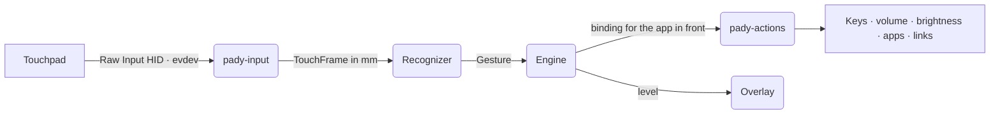

<p align="center">
  
</p>

<p align="center">
  <a href="https://github.com/lumidren/Pady/releases/latest"></a>
  <a href="https://github.com/lumidren/Pady/releases"></a>
  <a href="https://github.com/lumidren/Pady/actions/workflows/ci.yml"></a>
  
  
  
  <a href="LICENSE"></a>
</p>

<p align="center">
  <b>Your touchpad, finally awake.</b><br>
  Three-finger drag, plus 32 more gestures you can point at anything:<br>
  volume, brightness, media keys, shortcuts, apps, links. Per app, if you're picky.<br>
  Free and open source · Windows &amp; Linux · written in Rust · about 20 MB in the tray.
</p>

<p align="center">
  <a href="https://github.com/lumidren/Pady/releases/latest"><b>Download for Windows or Linux</b></a> ·
  <a href="https://lumidren.github.io/Pady/">Website &amp; live demo</a> ·
  <a href="https://www.youtube.com/watch?v=e4grMSxty78">Video</a> ·
  <a href="#quick-start">Quick start</a> ·
  <a href="#faq">FAQ</a> ·
  <a href="#how-it-works">How it works</a>
</p>

<p align="center">
  <a href="https://www.youtube.com/watch?v=e4grMSxty78"></a><br>
  <sub>Pady in 60 seconds (YouTube)</sub>
</p>

## Why Pady

- **More gestures than your OS gives you.** Tap, double tap, triple tap, hold, swipe in four directions, pinch in or out, and drag, each with 3, 4 or 5 fingers. That's 33 gestures you can bind.
- **Copy and paste with one hand.** Pinch three fingers together to copy, spread them to paste. A glowing "Copied" or "Pasted" notice confirms it.
- **Three-finger drag on Windows.** Move windows and select text without pressing the touchpad, like on a Mac.
- **Scrub, don't spam.** Keep sliding and volume, brightness or zoom keeps stepping. Volume and brightness glide in small steps, like a slider under your fingers.
- **Per-app profiles.** Swipes can switch browser tabs in Chrome and desktops everywhere else. Pady detects the app for you.
- **Feedback you can see.** A small pill in the corner says what happened: "Copied", "Pasted", a track skipped. Moving effects like the swipe glow are there if you want them.
- **Beginner friendly.** A first-run tutorial checks your touchpad, turns off clashing OS gestures, offers starter presets and lets you practise.
- **Keeps itself up to date.** A new version is one click away, from the tray or the app, and only installs if it carries Pady's update signature.
- **Light and private.** One small Rust process in the tray, no CPU while idle, no telemetry, no accounts, no ads.

## What's in each version

| | Feature | Where it is |
|---|---|---|
| ✅ | 33 gestures, a dozen kinds of action, per-app profiles, five starter presets, three-finger drag | **v1.0.0** (released 2026-10-29) |
| ✅ | Copy and paste with a three-finger pinch, corner notices, swipe glow, show touches | **v1.0.0** |
| ✅ | Auto-update, first-run tutorial, `pady-cli`, Linux packages that set up touchpad access | **v1.0.0** |
| 🔜 | **Switch keyboard language** as an action, with the language named in a corner notice | Next update (on `main`) |
| 🔜 | **Calmer defaults**: corner notices on, moving animations off, and a separate Notices section in Settings | Next update (on `main`) |
| 🔜 | **Config backups**: a copy before every change, and **Restore** in Settings | Next update (on `main`) |
| 🔜 | **Beta builds** for trying new things early (they never update themselves) | Next update (on `main`) |
| 🧪 | **Glyphs**: draw your own two-finger shapes (a circle, a V, a check mark) and bind them like any gesture | Coming soon. Built, but shown only in beta builds for now |
| 🧪 | **Translator**: select text, do a gesture, and a pop-up shows the translation (free MyMemory or DeepL, 38 languages) | Coming soon. Being built on the `translator` branch |

The full history is in [CHANGELOG.md](CHANGELOG.md).

## Videos

| Pady in 60 seconds | Copy and paste with a pinch |
|---|---|
| <a href="https://www.youtube.com/watch?v=e4grMSxty78"></a> | <a href="https://www.youtube.com/watch?v=aciO9Ana1ZE"></a> |
| **Glyphs (coming soon)** | **Translator (coming soon)** |
| <a href="https://www.youtube.com/watch?v=Cz4-n7IDi_s"></a> | <a href="https://www.youtube.com/watch?v=sNIkzMRkDb4"></a> |

<p align="center">
  
</p>

## Screenshots

| Gestures | Per-app profiles |
|---|---|
|  |  |
| **Live view** | **Guided setup** |
|  |  |
| **Settings** | **Level overlay** |
|  |  |

## Install

Download from the [latest release](https://github.com/lumidren/Pady/releases/latest):

| System | File | What happens |
|---|---|---|
| **Windows 10 / 11** | `Pady_<version>_x64-setup.exe` | Installs for you only, with no admin prompt, and adds Pady to the Start menu. If Microsoft WebView2 is missing, the installer downloads it. Nothing else is needed. |
| Windows (managed PCs) | `Pady_<version>_x64_en-US.msi` | Per-machine install for Intune or Group Policy. |
| **Ubuntu, Debian, Mint** | `Pady_<version>_amd64.deb` | `sudo apt install ./Pady_*_amd64.deb` pulls in every dependency and sets up touchpad access. |
| **Fedora, openSUSE** | `Pady-<version>-1.x86_64.rpm` | `sudo dnf install ./Pady-*.x86_64.rpm`, same as the .deb. |
| Any Linux | `Pady_<version>_amd64.AppImage` | `chmod +x` it and run. The tutorial's **Fix permissions** button sets up access and installs missing helper tools after one password prompt. |

> [!WARNING]
> **Windows: turn off Windows' own touchpad gestures first**, or Windows and Pady will both react to the same swipe. Open **Settings › Bluetooth & devices › Touchpad**, then under **Three-finger gestures** and **Four-finger gestures** set **Swipes** and **Taps** to **Nothing**. Pady's first-run setup walks you through it.

> [!NOTE]
> Windows may show *"Windows protected your PC"* for new apps. Click **More info → Run anyway**. Each release lists SHA-256 checksums for every file.

## Quick start

1. **Install and open Pady.** The tutorial starts by itself.
2. **Let it check your touchpad.** On Windows it shows how to switch off the OS's own three- and four-finger gestures, so the two don't fight. On Linux it offers **Fix permissions** if needed.
3. **Pick a starter preset**: Recommended, Like a Mac, Media, Productivity or Minimal.
4. **Practise.** The tutorial ticks off each gesture as you do it.

Then change anything: click a card on the **Gestures** page and choose what it does. Pady lives in the tray and starts with Windows (or Linux) by itself, so your gestures are always there. You can turn that off in Settings.

## Gestures

Every gesture works with 3, 4 or 5 fingers. Fewer fingers stay with your OS for pointing and scrolling.

| Gesture | Config name | Notes |
|---|---|---|
| Tap | `tap:N` | Touch and lift quickly. |
| Double tap | `doubletap:N` | Once a double or triple tap is bound, single taps wait a moment (300 ms by default) to tell them apart. |
| Triple tap | `tripletap:N` | |
| Hold | `hold:N` | Rest the fingers without moving (600 ms by default). |
| Swipe | `swipe:N:up` · `down` · `left` · `right` | With **repeat**, it keeps firing as you keep sliding. |
| Pinch | `pinch:N:in` · `out` | Fingers moving together or apart, with optional repeat. |
| Drag | `drag:N` | Holds the left mouse button while the fingers move. Takes over swipes for that finger count. |

## Actions

| Action | What it does |
|---|---|
| Keyboard shortcut | Any combo, e.g. `ctrl+shift+t`, `win+d`, `alt+f4`. Record it straight from your keyboard. |
| Volume ± / Mute | Exact steps on the default output device, with the level overlay. |
| Brightness ± | Laptop screens (WMI on Windows; brightnessctl, sysfs or logind on Linux) and external monitors (DDC/CI). |
| Media keys | Play/pause, next, previous, stop, and volume keys with the OS overlay. |
| Open a link | In your default browser or a specific one (Chrome, Edge, Firefox, Brave). |
| Launch an app | A program, path or URI such as `ms-settings:`. |
| Switch to an app | Brings it to the front, minimises it if it's already in front, and launches it if it isn't running. |
| Run a command | Anything your shell can run. |
| Lock the screen | |
| Drag | Three-finger drag style. Holds the left button while moving. |

## Starter presets

| Preset | In short |
|---|---|
| **Recommended** | Three-finger drag; three-finger tap plays or pauses and double tap skips the track; four-finger swipes change volume and brightness; four-finger pinch zooms; three-finger pinch copies and pastes. |
| **Like a Mac** | Three-finger drag, four-finger swipes for task view, the desktop and switching desktops, pinch to zoom, three-finger pinch to copy and paste. |
| **Media** | Single, double and triple taps play, skip and go back; four-finger swipes change the volume and track. |
| **Productivity** | Desktops, task view, screenshots and lock on four fingers, three-finger drag, and three-finger pinch to copy and paste. |
| **Minimal** | Only three-finger drag. |

Pick one in the tutorial or in Settings, or run `pady-cli config preset media`.

## Per-app profiles

A profile changes some gestures while specific apps are in front; everything else follows **All apps**. In the app, click **New profile** and use **Detect app**: switch to the app and Pady records its name. A gesture can also be switched off in an app.

```toml
[[profile]]
name = "Browser"
apps = ["chrome.exe", "msedge.exe", "firefox"]

[[profile.binding]]
trigger = "swipe:4:left"
action = { type = "keys", combo = "ctrl+shift+tab" }   # previous tab

[[profile.binding]]
trigger = "tap:4"
action = { type = "none" }                             # off in the browser
```

## Configuration

Everything you set in the window is saved to a readable TOML file. Edit it by hand if you like; changes apply instantly.

- Windows: `%APPDATA%\Pady\config.toml`
- Linux: `~/.config/pady/config.toml`

| Setting | Default | Meaning |
|---|---|---|
| `tap_max_ms` | 220 | A tap must lift within this many milliseconds… |
| `tap_slop_mm` | 4 | …and no finger may wander further than this. |
| `multi_tap_ms` | 300 | Longest gap between the taps of a double or triple tap. |
| `hold_ms` | 600 | Resting this long without moving counts as a hold. |
| `swipe_threshold_mm` | 10 | Travel before a swipe or drag starts. |
| `swipe_step_mm` | 7 | Spacing between repeats while sliding or pinching. |
| `pinch_threshold_mm` | 8 | Change in finger spread before a pinch starts. |
| `drag_speed` | 9 | Cursor pixels per millimetre while dragging. |
| `drag_acceleration` | 1 | How much faster quick flicks move the cursor. |
| `drag_release_ms` | 350 | Lift and re-place within this to keep dragging. |
| `show_overlay` | true | Show the level pill for volume and brightness. |
| `pause_in_fullscreen` | true | Ignore gestures while a game runs in exclusive full screen. |

## Command line

```text
pady-cli doctor           Check config, touchpad, clashing OS gestures and permissions
pady-cli monitor          Show fingers and recognised gestures live (no actions run)
pady-cli run              Run Pady headless with your config
pady-cli app              Print the app in front as you switch (names for profiles)
pady-cli presets          List starter presets
pady-cli config preset <id>   Apply a preset
pady-cli action <toml>    Run one action now: pady-cli action '{ type = "volume", step = 5 }'
pady-cli fix-permissions  Linux: install the udev rule and helper tools Pady needs
```

## FAQ

<details>
<summary><b>Windows still switches apps when I swipe with three fingers</b></summary>

Windows runs its own touchpad gestures alongside Pady, and apps can read touchpad input but not block it. Open **Settings › Bluetooth & devices › Touchpad › Three-finger gestures** (and four-finger) and set *Swipes* and *Taps* to **Nothing**. Pady shows a banner with a button to that page whenever this is needed. Five-finger gestures never clash.
</details>

<details>
<summary><b>Nothing happens on Linux</b></summary>

Run `pady-cli doctor`. If Pady can't read the touchpad or send keys, click **Fix permissions** in the app or run `pady-cli fix-permissions`. The .deb and .rpm packages do this when installed. GNOME uses three-finger swipes and KDE uses four-finger swipes for their own gestures, so pick other finger counts or turn theirs off.
</details>

<details>
<summary><b>Does it work on Wayland?</b></summary>

Gestures and all actions work. Switching to an app and per-app profiles need to know which window is in front. That works for X11 and XWayland apps, and on KDE Plasma with `kdotool`; on other Wayland desktops those two features fall back gracefully.
</details>

<details>
<summary><b>Which touchpads are supported?</b></summary>

On Windows, any **Precision Touchpad**, which covers most laptops from the last several years. On Linux, any multitouch touchpad the kernel exposes through evdev, including ones that report fewer finger slots than fingers.
</details>

<details>
<summary><b>How much memory does it use?</b></summary>

With the window closed, Pady runs without any web view: one process using about 20–40 MB (under 8 MB of it private), and no CPU time at all while you aren't touching the pad. Opening the window starts WebView2, which takes a few hundred MB more until you close the window again. Measured on Windows 11 with Pady 0.3.0.
</details>

<details>
<summary><b>Where are the logs?</b></summary>

Windows: `%LOCALAPPDATA%\com.lumidren.pady\logs`. Linux: `~/.local/share/com.lumidren.pady/logs`. They hold gestures and errors, never what you type.
</details>

## How it works



- **Real finger data.** Pady reads each finger's position from the touchpad, converted to millimetres, so thresholds feel the same on every laptop.
- **A tested recognizer.** It measures movement only from fingers present in consecutive frames, so fingers landing or lifting never look like a jump. About 160 unit tests cover taps, multi-taps, holds, swipes, pinches and drags, the config format, the Linux multitouch decoder and the overlay, and fuzz tests throw random device reports, configs and frames at every parser.
- **Actions never block touch.** Recognition and actions run on separate threads. The engine sleeps until the next frame or the next timer that's due.

| Crate | Purpose |
|---|---|
| `pady-core` | Recognizer, config, presets and engine. Platform-independent and fully unit-tested. |
| `pady-input` | Windows Raw Input and Linux evdev touchpad backends. |
| `pady-actions` | Keys, audio, brightness, apps, autostart and permissions per OS. |
| `pady-overlay` | The native Windows level overlay (no web view). |
| `pady-cli` | The terminal tool. |
| `pady-app` | The Tauri desktop app and its UI. |

## Build from source

You need [Rust](https://rustup.rs) 1.82+.

- **Windows:** Visual Studio Build Tools (*Desktop development with C++*).
- **Linux:** `sudo apt install libwebkit2gtk-4.1-dev libayatana-appindicator3-dev librsvg2-dev libxdo-dev libssl-dev`

```bash
git clone https://github.com/lumidren/Pady
cd Pady
cargo run -p pady-app --release
```

To build the installers yourself, run this in `crates/pady-app`: `npx @tauri-apps/cli@2 build` (add `--bundles nsis,msi` on Windows, or `deb,rpm,appimage` on Linux). [RELEASING.md](RELEASING.md) covers releases and code signing; [CONTRIBUTING.md](CONTRIBUTING.md) covers development, including the UI preview that runs without the backend.

Ideas welcome! Open an [issue](https://github.com/lumidren/Pady/issues/new/choose).

## Code signing policy

Windows releases are signed so you can check they come from this project. Free code signing provided by [SignPath.io](https://about.signpath.io), certificate by [SignPath Foundation](https://signpath.org).

- **Committers and reviewers:** [lumidren](https://github.com/lumidren)
- **Approvers:** [lumidren](https://github.com/lumidren)

Only what is built from this repository by the [Release workflow](.github/workflows/release.yml) on GitHub Actions is signed: the workflow builds the installers from a version tag, sends them to SignPath, and attaches the signed files with SHA-256 checksums to a draft release that the maintainer publishes. Every signing request is approved by hand. Changes from other contributors are reviewed before they are merged. The maintainer's GitHub and SignPath accounts use multi-factor authentication.

### Privacy

Pady will not transfer any information to other networked systems unless specifically requested by the user or the person installing or operating it, with one exception you can turn off: twice a day it asks GitHub whether a newer version exists (`github.com/lumidren/Pady/releases/latest/download/latest.json`). That request carries no information about you or your PC beyond what any web request does, and you can switch it off under **Settings › Check for updates**. Pady has no accounts, no ads and no telemetry, reads only the touchpad, and never reads what you copy.

## Made by

**lumidren**, designed, coded and shipped solo, because the Mac trackpad shouldn't get to have all the fun.

[LinkedIn](https://www.linkedin.com/in/lumidren) · [GitHub](https://github.com/lumidren) · [Website](https://lumidren.github.io/Pady/)

## License

Pady is open source under the [MIT license](LICENSE).
