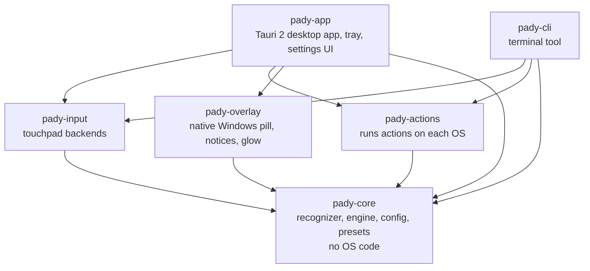
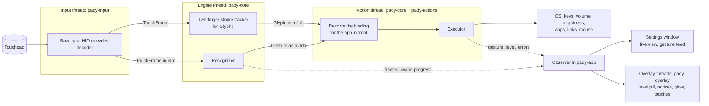
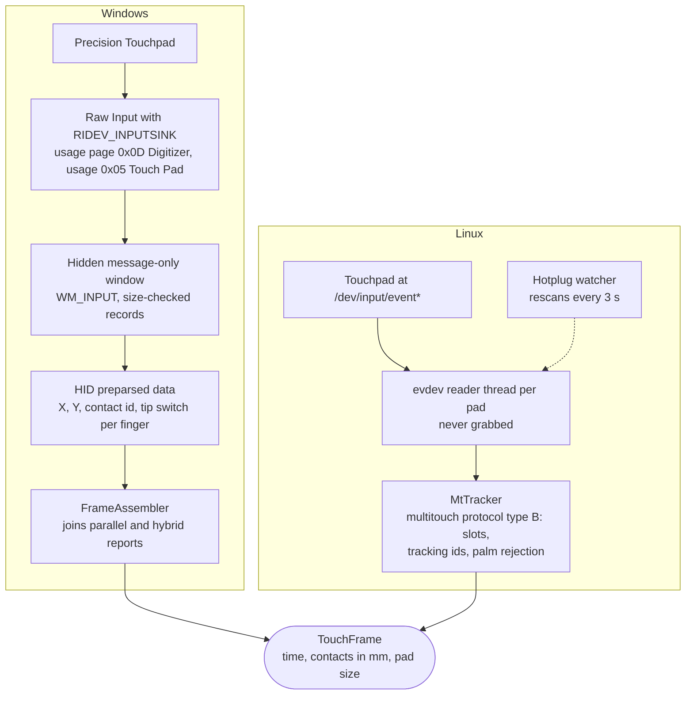
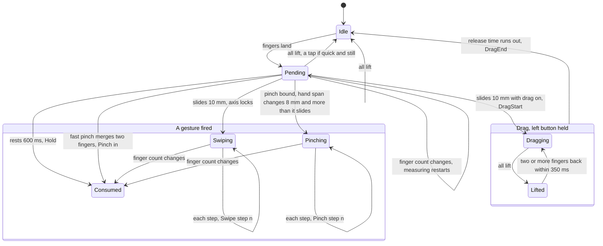
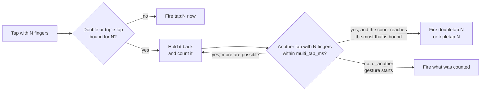
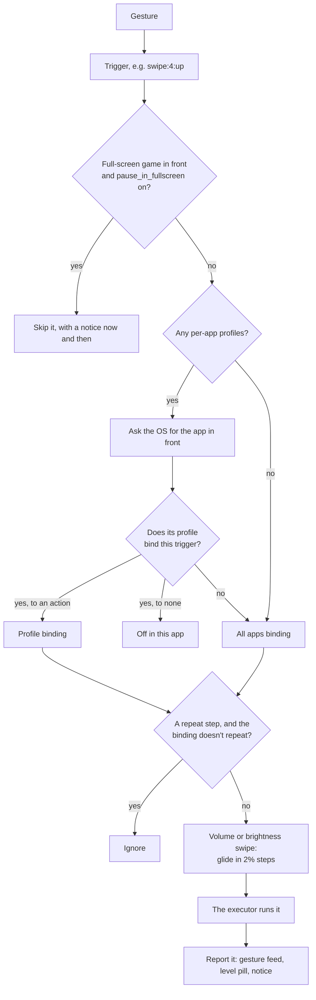
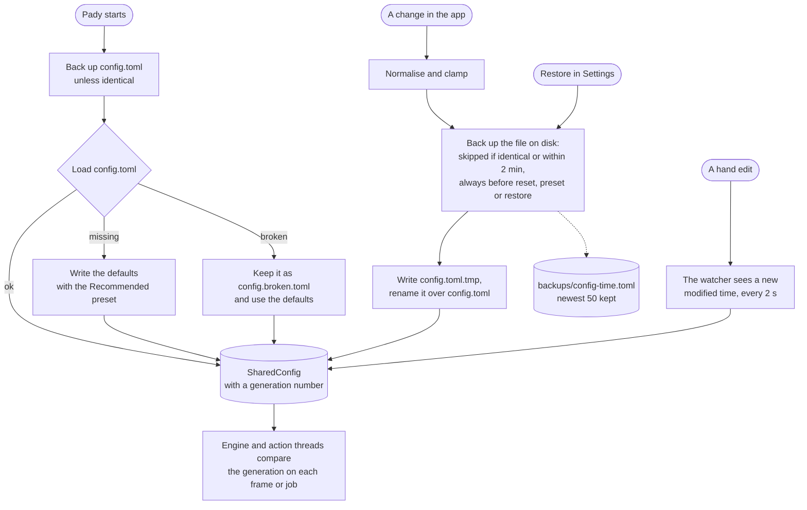
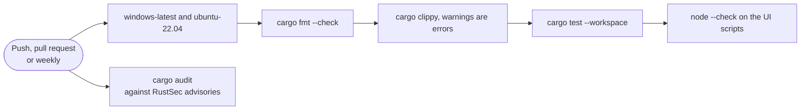
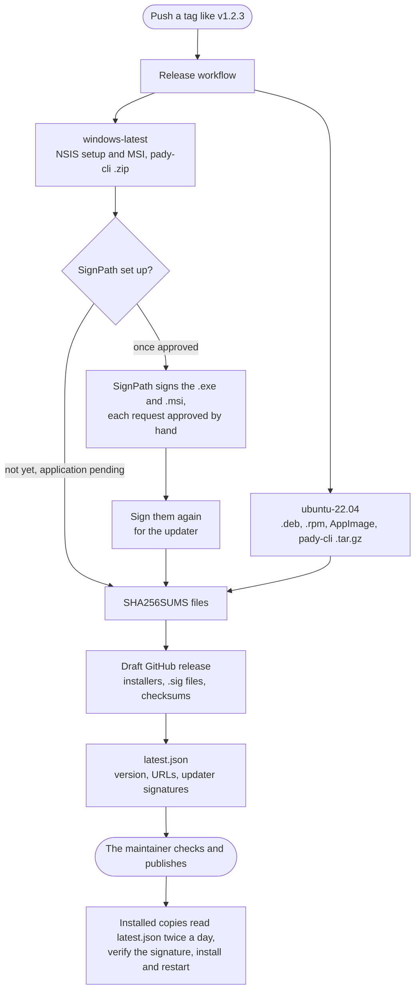

<p align="center">
  
</p>

<p align="center">
  <a href="https://github.com/lumidren/Pady/releases/latest"></a>
  <a href="https://github.com/lumidren/Pady/releases"></a>
  <a href="https://github.com/lumidren/Pady/actions/workflows/ci.yml"></a>
  
  
  
  <a href="LICENSE"></a>
</p>

<p align="center">
  <b>Your touchpad, finally awake.</b><br>
  Three-finger drag, plus 32 more gestures you can point at anything:<br>
  volume, brightness, media keys, shortcuts, apps, links. Per app, if you're picky.<br>
  Free and open source · Windows &amp; Linux · written in Rust · about 20 MB in the tray.
</p>

<p align="center">
  <a href="https://github.com/lumidren/Pady/releases/latest"><b>Download for Windows or Linux</b></a> ·
  <a href="https://lumidren.github.io/Pady/">Website &amp; live demo</a> ·
  <a href="https://www.youtube.com/watch?v=e4grMSxty78">Video</a> ·
  <a href="#quick-start">Quick start</a> ·
  <a href="#faq">FAQ</a> ·
  <a href="#how-it-works">How it works</a>
</p>

<p align="center">
  <a href="https://www.youtube.com/watch?v=e4grMSxty78"></a><br>
  <sub>Pady in 60 seconds (YouTube)</sub>
</p>

## Why Pady

- **More gestures than your OS gives you.** Tap, double tap, triple tap, hold, swipe in four directions, pinch in or out, and drag, each with 3, 4 or 5 fingers. That's 33 gestures you can bind.
- **Copy and paste with one hand.** Pinch three fingers together to copy, spread them to paste. A glowing "Copied" or "Pasted" notice confirms it.
- **Three-finger drag on Windows.** Move windows and select text without pressing the touchpad, like on a Mac.
- **Scrub, don't spam.** Keep sliding and volume, brightness or zoom keeps stepping. Volume and brightness glide in small steps, like a slider under your fingers.
- **Per-app profiles.** Swipes can switch browser tabs in Chrome and desktops everywhere else. Pady detects the app for you.
- **Feedback you can see.** A small pill in the corner says what happened: "Copied", "Pasted", a track skipped. Moving effects like the swipe glow are there if you want them.
- **Beginner friendly.** A first-run tutorial checks your touchpad, turns off clashing OS gestures, offers starter presets and lets you practise.
- **Keeps itself up to date.** A new version is one click away, from the tray or the app, and only installs if it carries Pady's update signature.
- **Light and private.** One small Rust process in the tray, no CPU while idle, no telemetry, no accounts, no ads.

## What's in each version

| | Feature | Where it is |
|---|---|---|
| ✅ | 33 gestures, a dozen kinds of action, per-app profiles, five starter presets, three-finger drag | **v1.0.0** (released 2026-10-29) |
| ✅ | Copy and paste with a three-finger pinch, corner notices, swipe glow, show touches | **v1.0.0** |
| ✅ | Auto-update, first-run tutorial, `pady-cli`, Linux packages that set up touchpad access | **v1.0.0** |
| 🔜 | **Switch keyboard language** as an action, with the language named in a corner notice | Next update (on `main`) |
| 🔜 | **Calmer defaults**: corner notices on, moving animations off, and a separate Notices section in Settings | Next update (on `main`) |
| 🔜 | **Config backups**: a copy before every change, and **Restore** in Settings | Next update (on `main`) |
| 🔜 | **Beta builds** for trying new things early (they never update themselves) | Next update (on `main`) |
| 🧪 | **Glyphs**: draw your own two-finger shapes (a circle, a V, a check mark) and bind them like any gesture | Coming soon. Built, but shown only in beta builds for now |
| 🧪 | **Translator**: select text, do a gesture, and a pop-up shows the translation (free MyMemory or DeepL, 38 languages) | Coming soon. Being built on the `translator` branch |

The full history is in [CHANGELOG.md](CHANGELOG.md).

## Videos

| Pady in 60 seconds | Copy and paste with a pinch |
|---|---|
| <a href="https://www.youtube.com/watch?v=e4grMSxty78"></a> | <a href="https://www.youtube.com/watch?v=aciO9Ana1ZE"></a> |
| **Glyphs (coming soon)** | **Translator (coming soon)** |
| <a href="https://www.youtube.com/watch?v=Cz4-n7IDi_s"></a> | <a href="https://www.youtube.com/watch?v=sNIkzMRkDb4"></a> |

<p align="center">
  
</p>

## Screenshots

| Gestures | Per-app profiles |
|---|---|
|  |  |
| **Live view** | **Guided setup** |
|  |  |
| **Settings** | **Level overlay** |
|  |  |

## Install

Download from the [latest release](https://github.com/lumidren/Pady/releases/latest). Sizes are for v1.0.0.

| System | File | Size | What happens |
|---|---|---|---|
| **Windows 10 / 11** | `Pady_<version>_x64-setup.exe` | 5.6 MB | Installs for you only, with no admin prompt, and adds Pady to the Start menu. If Microsoft WebView2 is missing, the installer downloads it. Nothing else is needed. |
| Windows (managed PCs) | `Pady_<version>_x64_en-US.msi` | 7.3 MB | Per-machine install for Intune or Group Policy. |
| **Ubuntu, Debian, Mint** | `Pady_<version>_amd64.deb` | 5.4 MB | `sudo apt install ./Pady_*_amd64.deb` pulls in every dependency and sets up touchpad access. |
| **Fedora, openSUSE** | `Pady-<version>-1.x86_64.rpm` | 5.4 MB | `sudo dnf install ./Pady-*.x86_64.rpm`, same as the .deb. |
| Any Linux | `Pady_<version>_amd64.AppImage` | 84 MB | `chmod +x` it and run. The tutorial's **Fix permissions** button sets up access and installs missing helper tools after one password prompt. |
| Terminal tool only | `pady-cli-<version>-windows-x64.zip` or `-linux-x64.tar.gz` | about 1 MB | The optional [`pady-cli`](#command-line). |

Every release also lists SHA-256 checksums for every file (`SHA256SUMS-windows.txt`, `SHA256SUMS-linux.txt`).

> [!WARNING]
> **Windows: turn off Windows' own touchpad gestures first**, or Windows and Pady will both react to the same swipe. Open **Settings › Bluetooth & devices › Touchpad**, then under **Three-finger gestures** and **Four-finger gestures** set **Swipes** and **Taps** to **Nothing**. Pady's first-run setup walks you through it.

> [!NOTE]
> The Windows installer is not code-signed yet (see the [code signing policy](#code-signing-policy)), so Windows may show *"Windows protected your PC"*. Click **More info › Run anyway**. You can compare the file with the published SHA-256 checksum first.

**Uninstalling** works like any other app (Settings › Apps on Windows, your package manager on Linux). It also removes Pady from start-up, and can remove your settings.

## Quick start

1. **Install and open Pady.** The tutorial starts by itself.
2. **Let it check your touchpad.** On Windows it shows how to switch off the OS's own three- and four-finger gestures, so the two don't fight. On Linux it offers **Fix permissions** if needed.
3. **Pick a starter preset**: Recommended, Like a Mac, Media, Productivity or Minimal.
4. **Practise.** The tutorial ticks off each gesture as you do it.

Then change anything: click a card on the **Gestures** page and choose what it does, or press **Test** to try an action without the gesture. Pady lives in the tray and starts with your computer, so your gestures are always there. You can turn that off in Settings. To pause every gesture for a while, untick **Gestures on** in the tray menu.

## Gestures

Every gesture works with 3, 4 or 5 fingers. One and two fingers stay with your OS for pointing and scrolling.

| Gesture | Config name | How to do it |
|---|---|---|
| Tap | `tap:N` | Touch and lift within 220 ms, without moving more than 4 mm. |
| Double tap | `doubletap:N` | Two taps, the second starting within 300 ms of the first lift. |
| Triple tap | `tripletap:N` | Three taps in a row. |
| Hold | `hold:N` | Rest the fingers without moving for 600 ms. |
| Swipe | `swipe:N:up` · `down` · `left` · `right` | Slide 10 mm. With **repeat** it keeps firing every 7 mm as you keep sliding. |
| Pinch | `pinch:N:in` · `out` | Close or open your hand by 8 mm. With **repeat** it keeps stepping as you keep pinching. |
| Drag | `drag:N` | Slide, and Pady holds the left mouse button while the fingers move. Lift and put them back within 350 ms to keep dragging. |

The numbers are the defaults; you can change all of them in Settings.

**33 gestures:** 3 finger counts × 11 (tap, double tap, triple tap, hold, 4 swipes, 2 pinches, drag).

A few rules keep them apart:

- **Taps only wait when they have to.** If no double or triple tap is bound for that finger count, a tap fires the moment you lift. If one is bound, a single tap waits up to 300 ms to see whether another follows.
- **Drag takes over swipes.** When `drag:3` is on, three fingers moving always drag, so three-finger swipes are not used. The app marks those cards.
- **Pinches are only looked for when one is bound.** Then a hand that closes or opens more than it slides is a pinch, whatever its angle. Otherwise a sloppy swipe can never turn into a pinch.

## Actions

| Action | What it does | In the config file |
|---|---|---|
| Keyboard shortcut | Any combo, e.g. `ctrl+shift+t`, `win+d`, `alt+f4`. Record it straight from your keyboard. | `{ type = "keys", combo = "ctrl+shift+t" }` |
| Volume up / down | Exact steps on the default output device. On Windows, Windows shows its own volume slider. | `{ type = "volume", step = 4 }` |
| Mute | Toggles mute on the default output device. | `{ type = "mute" }` |
| Brightness up / down | Laptop screens (WMI on Windows; brightnessctl, sysfs or logind on Linux) and external monitors (DDC/CI). | `{ type = "brightness", step = 10 }` |
| Media keys | Play/pause, next, previous, stop, and the volume keys. | `{ type = "media", key = "play_pause" }` |
| Open a link | In your default browser or a specific one (Chrome, Edge, Firefox, Brave). | `{ type = "open_url", url = "https://…", browser = "chrome" }` |
| Launch an app | A program, path or URI such as `ms-settings:`. Browse for it, or type its name as it appears in Start. | `{ type = "launch", program = "notepad.exe" }` |
| Switch to an app | Brings it to the front, minimises it if it's already in front, and launches it if it isn't running. | `{ type = "focus_or_launch", program = "chrome.exe" }` |
| Run a command | Anything your shell can run (`cmd /C` on Windows, `sh -c` on Linux). | `{ type = "run", command = "…" }` |
| Lock the screen | Locks your session. | `{ type = "lock" }` |
| Drag | Three-finger drag style: holds the left button while the fingers move. For drag gestures. | `{ type = "drag" }` |
| Switch keyboard language *(next update)* | Presses Win+Space, and a corner notice names the language, like "Arabic" or "English". | `{ type = "keys", combo = "win+space" }` |
| Nothing | Switches a gesture off, for example inside one app. | `{ type = "none" }` |

The gesture editor also has one-click choices for common jobs: zoom in and out, show desktop, task view (overview on Linux), next and previous desktop, screenshot, close window, open Chrome, open YouTube. They are shortcuts or actions from the table, picked to suit Windows or Linux.

## Starter presets

Pick one in the tutorial or in Settings, or run `pady-cli config preset <id>`. A preset replaces the **All apps** gestures; your per-app profiles stay. A new install starts with **Recommended**.

| Gesture | Recommended | Like a Mac | Media | Productivity | Minimal |
|---|---|---|---|---|---|
| 3-finger drag | Drag | Drag | Drag | Drag | Drag |
| 3-finger tap | Play / pause | Play / pause | Play / pause | Play / pause | |
| 3-finger double tap | Next track | | Next track | | |
| 3-finger triple tap | | | Previous track | | |
| 3-finger pinch in / out | Copy / paste | Copy / paste | | Copy / paste | |
| 4-finger swipe up / down | Volume up / down (repeats) | Task view / show desktop | Volume up / down (repeats) | Task view / show desktop | |
| 4-finger swipe left / right | Brightness down / up (repeats) | Next / previous desktop | Previous / next track | Next / previous desktop | |
| 4-finger tap | Show desktop | | Mute | Screenshot | |
| 4-finger hold | Lock | | | Lock | |
| 4-finger pinch out / in | Zoom in / out (repeats) | Zoom in / out (repeats) | | Zoom in / out (repeats) | |

Shortcuts follow your OS. On Windows, task view is `win+tab`, desktops are `win+ctrl+left/right` and a screenshot is `win+shift+s`. On Linux they are `win` (overview), `win+pageup/pagedown` and `printscreen`. Like on a Mac, fingers moving left bring in the desktop on the right.

Preset ids are `recommended`, `macos`, `media`, `productivity` and `minimal`; `pady-cli presets` lists them.

## Per-app profiles

A profile changes some gestures while specific apps are in front; everything else follows **All apps**. In the app, click **New profile** and use **Detect app**: switch to the app and Pady records its name. A gesture can also be switched off in an app.

App names are matched loosely: `C:\Apps\Code.EXE`, `code.exe` and `Code` are the same app. `pady-cli app` prints the name of each app as you switch to it.

```toml
[[profile]]
name = "Browser"
apps = ["chrome.exe", "msedge.exe", "firefox"]

[[profile.binding]]
trigger = "swipe:4:left"
action = { type = "keys", combo = "ctrl+shift+tab" }   # previous tab

[[profile.binding]]
trigger = "swipe:4:right"
action = { type = "keys", combo = "ctrl+tab" }         # next tab

[[profile.binding]]
trigger = "tap:4"
action = { type = "none" }                             # off in the browser
```

## Notices and animations

On Windows, Pady draws its own small notices. They never take focus or clicks.

| Notice or effect | Default | What it shows |
|---|---|---|
| Copied | On | A pill in the top-right corner when you copy in the app in front. Pady is told *that* you copied, never *what*. |
| Pasted, track changes, play/pause | On | Actions you couldn't otherwise see. |
| Pinch steps | On | Counts each zoom step while you pinch. |
| Gestures paused | On | Says when a gesture was skipped because a full-screen game is in front. |
| Keyboard language | On | Names the language when you switch it. |
| Screenshot | Off *(next update)* | The screenshot tool already shows itself. |
| Level pill | Off on Windows, on on Linux | The volume or brightness level while you scrub. Windows has its own volume slider. |
| Swipe glow | Off | A soft glow at the screen edge a swipe is heading for, flashing when it fires. |
| Gesture hints | Off | Names each gesture and what it did, while you learn. |
| Show touches | Off | Glowing fingertips on a small touchpad in the corner, for recording tutorials. |
| Previews, live touchpad, celebrations | Off | Animations inside the Pady window. |

These are the calmer defaults of the next update. In v1.0.0 the notices and the moving animations share one **Animations** switch. Glow, glow strength, animation speed and how long notices stay can all be adjusted, and a new default never changes a setting you've already saved.

## Configuration

Everything you set in the window is saved to a readable TOML file. Edit it by hand if you like: Pady notices the change within about two seconds and applies it, with no restart. If the file can't be read, Pady keeps it as `config.broken.toml` and starts with the defaults.

| System | Config file | Logs |
|---|---|---|
| Windows | `%APPDATA%\Pady\config.toml` | `%LOCALAPPDATA%\com.lumidren.pady\logs` |
| Linux | `~/.config/pady/config.toml` | `~/.local/share/com.lumidren.pady/logs` |

`pady-cli config path` prints the location, and **Settings** has a button that opens the folder. Logs are rotated at 1 MB and hold gestures and errors, never what you type.

<details>
<summary><b>An example config</b></summary>

```toml
[settings]
enabled = true
tap_max_ms = 220
swipe_threshold_mm = 10.0
swipe_step_mm = 7.0
hold_ms = 600
pause_in_fullscreen = true
check_updates = true

# All apps
[[binding]]
trigger = "drag:3"
action = { type = "drag" }

[[binding]]
trigger = "tap:3"
action = { type = "media", key = "play_pause" }

[[binding]]
trigger = "swipe:4:up"
action = { type = "volume", step = 4 }
repeat = true                  # keep stepping while the fingers keep sliding

[[binding]]
trigger = "pinch:3:in"
action = { type = "keys", combo = "ctrl+c" }

[[binding]]
trigger = "hold:5"
action = { type = "open_url", url = "https://github.com/lumidren/Pady", browser = "firefox" }

# Only while VS Code is in front
[[profile]]
name = "Code"
apps = ["code"]

[[profile.binding]]
trigger = "swipe:4:left"
action = { type = "keys", combo = "ctrl+pageup" }
```

Settings you leave out take their defaults, and a later binding for the same trigger replaces an earlier one. The top of the file Pady writes lists every trigger and action.
</details>

### Settings

All distances are millimetres on the touchpad surface, so they feel the same on every laptop. Hand-edited values are kept within a workable range.

| Setting | Default | Meaning |
|---|---|---|
| `enabled` | true | Master switch. When off, Pady watches but never acts. |
| `tap_max_ms` | 220 | A tap must lift within this many milliseconds… |
| `tap_slop_mm` | 4 | …and no finger may wander further than this. |
| `multi_tap_ms` | 300 | Longest gap between the taps of a double or triple tap. |
| `hold_ms` | 600 | Resting this long without moving counts as a hold. |
| `swipe_threshold_mm` | 10 | Travel before a swipe or drag starts. |
| `swipe_step_mm` | 7 | Spacing between repeats while sliding. Volume and brightness swipes glide 3.5 times as often, in 2% steps. Pinches step every 14 mm of hand span. |
| `pinch_threshold_mm` | 8 | Change in hand span before a pinch starts. |
| `drag_speed` | 9 | Cursor pixels per millimetre while dragging. |
| `drag_acceleration` | 1 | How much faster quick flicks move the cursor (0 = linear). |
| `drag_release_ms` | 350 | Lift and re-place within this to keep dragging (0 = let go at once). |
| `show_overlay` | false on Windows, true on Linux | The level pill for volume and brightness. |
| `pause_in_fullscreen` | true | Ignore gestures while a game runs in exclusive full screen (Windows). |
| `show_copy_notice` | true | The "Copied" notice (Windows). |
| `check_updates` | true | Look for a new version on GitHub twice a day. |

The animation and notice switches (`animations`, `anim_*`, `glow_strength`, `anim_speed`, `notice_time`) are easiest to set in **Settings**.

### Backups

*Next update.* Before Pady changes your config, it keeps a copy in a `backups` folder next to it (`config-<time>.toml`), so a slip in the app, a bad import or a broken update can always be undone. **Settings › Backups** lists the copies with how many gestures, profiles and glyphs each holds, and **Restore** brings one back. The current config is copied first, so a restore can itself be undone.

- One copy each time Pady starts, and before every save.
- Identical copies are skipped. While you're busy changing things, only the state from before the burst is kept (at most one copy per two minutes), so a dozen toggles don't push real history out.
- Resetting, applying a preset and restoring always take a copy.
- The newest 50 copies are kept.

## Command line

`pady-cli` is a small terminal companion. It's a separate download on the release page, or build it with `cargo build --release -p pady-cli`.

```text
pady-cli doctor                Check config, touchpad, clashing OS gestures and permissions
pady-cli devices               List detected touchpads
pady-cli monitor               Show fingers and recognised gestures live (no actions run)
pady-cli run                   Run Pady headless with your config (actions run)
pady-cli app                   Print the app in front as you switch (names for profiles)
pady-cli action <toml>         Run one action now: pady-cli action '{ type = "volume", step = 5 }'
pady-cli presets               List starter presets
pady-cli config [path]         Print where the config file is
pady-cli config show           Print the config
pady-cli config reset          Go back to the defaults
pady-cli config preset <id>    Apply a preset
pady-cli fix-permissions       Linux: install the udev rule and helper tools Pady needs
```

Set `RUST_LOG=debug` for more detail.

## FAQ

<details>
<summary><b>Windows still switches apps when I swipe with three fingers</b></summary>

Windows runs its own touchpad gestures alongside Pady, and apps can read touchpad input but not block it. Open **Settings › Bluetooth & devices › Touchpad › Three-finger gestures** (and four-finger) and set *Swipes* and *Taps* to **Nothing**. Pady shows a banner with a button to that page whenever this is needed. Five-finger gestures never clash.
</details>

<details>
<summary><b>Nothing happens on Linux</b></summary>

Run `pady-cli doctor`. If Pady can't read the touchpad or send keys, click **Fix permissions** in the app or run `pady-cli fix-permissions`. The .deb and .rpm packages do this when installed. GNOME uses three-finger swipes and KDE uses four-finger swipes for their own gestures, so pick other finger counts or turn theirs off.
</details>

<details>
<summary><b>Does it work on Wayland?</b></summary>

Gestures and all actions work: keys and the drag button go through a virtual input device, which works the same on X11 and Wayland. Switching to an app and per-app profiles need to know which window is in front. That works for X11 and XWayland apps, and on KDE Plasma with `kdotool`; on other Wayland desktops those two features fall back gracefully.
</details>

<details>
<summary><b>Which touchpads are supported?</b></summary>

On Windows, any **Precision Touchpad**, which covers most laptops from the last several years. On Linux, any multitouch touchpad the kernel exposes through evdev, including ones that report fewer finger slots than fingers. Touchpads plugged in later (USB, Bluetooth) are picked up too.
</details>

<details>
<summary><b>How much memory does it use?</b></summary>

With the window closed, Pady runs without any web view: one process using about 20 MB (a 21.7 MB working set, 4.8 MB of it private, measured on Windows 11), and no CPU time at all while you aren't touching the pad. Opening the window starts WebView2, which takes a few hundred MB more until you close the window again.
</details>

<details>
<summary><b>Does it slow down games?</b></summary>

No. Pady sleeps until the touchpad reports something. By default it also ignores gestures while a game runs in exclusive full screen, and tells you when it skipped one.
</details>

<details>
<summary><b>Does it read what I copy or type?</b></summary>

No. Pady reads only the touchpad. For the "Copied" notice, Windows tells Pady *that* the clipboard changed, never what's in it.
</details>

<details>
<summary><b>Is there a macOS version?</b></summary>

No. Macs already have rich trackpad gestures, and Pady is built on the Windows Precision Touchpad and Linux evdev interfaces.
</details>

## Troubleshooting

| Problem | Fix |
|---|---|
| Windows reacts to a gesture as well as Pady | Set Windows' three- and four-finger **Swipes** and **Taps** to **Nothing** (see the warning under [Install](#install)), or use five fingers. |
| "No touchpad found" on Windows | Pady needs a Precision Touchpad. **Settings › Bluetooth & devices › Touchpad** shows whether you have one. |
| Nothing happens on Linux | Run `pady-cli doctor`, then **Fix permissions** or `pady-cli fix-permissions`. |
| A Linux action fails | The app flags bindings that need a helper tool (brightnessctl, xdotool, wmctrl, playerctl). **Fix permissions** installs the missing ones. |
| Three-finger swipes do nothing | Three-finger drag is on, and drag takes over swipes for that finger count. Turn it off or use four fingers. |
| Single taps feel slow | A double or triple tap is bound for that finger count, so single taps wait to tell them apart. Shorten **Double-tap speed** or unbind the multi-tap. |
| Gestures stop in a game | `pause_in_fullscreen` is on. That's on purpose; turn it off in Settings if you want gestures there. |
| Gestures stopped after sleep | Pady checks its touchpad listener every two seconds and replaces it after sleep or if it stops. If it still doesn't recover, quit and reopen Pady and [report a bug](https://github.com/lumidren/Pady/issues/new/choose) with the log. |
| A hand edit went wrong | Restore a copy from **Settings › Backups** *(next update)*, or run `pady-cli config reset`. |

For bug reports, include the output of `pady-cli doctor` and the log (see [Configuration](#configuration)). The app's **About** page has *Report a bug*, *Suggest a feature* and *Share feedback* buttons that fill in your Pady version.

## Privacy and security

Pady will not transfer any information to other networked systems unless specifically requested by the user or the person installing or operating it, with one exception you can turn off: twice a day it asks GitHub whether a newer version exists (`github.com/lumidren/Pady/releases/latest/download/latest.json`). That request carries no information about you or your PC beyond what any web request does, and you can switch it off under **Settings › Check for updates**. Pady has no accounts, no ads and no telemetry, reads only the touchpad, and never reads what you copy.

- **Touchpad only.** On Windows, Pady registers for the touchpad's Raw Input collection, never the keyboard. On Linux, the udev rule gives the signed-in user access to touchpads and `/dev/uinput`, not keyboards or mice.
- **Signed updates.** The updater installs a new version only if it's signed with Pady's updater key.
- **A locked-down window.** The settings window runs only the app's own files under a strict Content Security Policy, and only it may call Pady's commands.
- **Careful with input.** What devices report and what hand-edited files say is bounds-checked and fuzz tested.
- **Audited dependencies.** CI checks every dependency against the RustSec advisory database on each push and once a week.

Found a vulnerability? Please report it privately, as described in [SECURITY.md](SECURITY.md), which also explains every permission Pady uses and why.

## How it works

### Architecture

Pady is a Cargo workspace of six crates. The gesture logic in `pady-core` has no OS code at all, so it's tested the same way on every platform. Everything OS-specific sits around it.



| Crate | Purpose | Main modules |
|---|---|---|
| `pady-core` | Turns touch frames into gestures and gestures into jobs. Config, presets, backups. Platform-independent and fully unit-tested. | `recognizer`, `engine`, `config`, `trigger`, `gesture`, `action`, `presets`, `backups`, `glyphs`, `keys` |
| `pady-input` | Touchpad backends: Windows Raw Input and Linux evdev. Thread priority and timer precision. | `windows`, `hid`, `linux`, `mt`, `sched` |
| `pady-actions` | Keys, audio, brightness, apps, links, lock, autostart, permissions and OS-gesture conflict checks. | `windows`, `linux` |
| `pady-overlay` | Native Windows layered windows drawn with GDI+: the level pill, corner notices, swipe glow and touches. | `windows`, `toast`, `fx`, `glow`, `anim`, `notice`, `layout`, `shadow` |
| `pady-app` | The Tauri app: tray, commands, watchdog, updater. The UI is plain HTML/CSS/JS with no build step. | `main`, `update`, `feedback`, `responsive`, `ui/` |
| `pady-cli` | `doctor`, `monitor`, `run` and the rest. | `main` |

### Threads and data flow

Data flows one way. Each stage runs on its own thread and hands over through channels, so a slow action never delays touch handling.



- The **engine thread** sleeps until a frame arrives or the next timer (hold, double tap, drag release) is due. With nothing pending it never wakes up.
- The **action thread** owns the OS handles (COM on Windows) and runs jobs in order.
- The **observer** passes events to the settings window (only while it's open, at most about 60 frames a second) and to the native overlay threads, which sleep while nothing is on screen.
- A **watchdog** in the app checks the touchpad listener every two seconds. It starts a fresh one after sleep, if the old one stopped, or if no touch arrived for a long time while the computer was in use. The same loop picks up hand edits to the config file.

### Touchpad input

Both backends only listen. They never grab the device, so the OS keeps pointing, clicking and scrolling. Every finger is reported in millimetres from the pad's top-left corner.



- **Windows.** Registering with `RIDEV_INPUTSINK` means reports arrive even while another app has focus. Some pads have fewer finger slots than fingers they can sense and split a frame over several reports ("hybrid" mode); the assembler puts it back together.
- **Linux.** The kernel only sends what changed, so the tracker remembers each slot's last state and yields a frame whenever a packet changes the contacts. Contacts the kernel marks as a palm are left out.
- **Scheduling.** On Windows the input, engine and action threads run at the highest normal priority. Pady asks for 1 ms timers only while a hold, double tap or drag release is pending, so idle battery use is unchanged. On Linux timers are already precise.

### Gesture recognition

A *session* lasts from the first finger landing until the last one lifts. Within it the [recognizer](crates/pady-core/src/recognizer.rs) is in one phase at a time. Movement and spread are measured only from fingers present in consecutive frames, so a finger landing or lifting never looks like a jump. A finger at an impossible position is ignored, as if it had briefly lifted.



- **Pending** is where every decision is made. Swipes, pinches, drags and holds fire as soon as they're recognised. A **tap** is decided when the fingers lift: they lifted within `tap_max_ms`, no finger wandered more than `tap_slop_mm`, and nothing else fired. A tap counts the most fingers that were down.
- **Pinch or swipe?** A pinch is judged by the hand's *span* (the two fingers furthest apart), which moves by the full distance even when only the thumb does the pinching. In a close call, the recognizer waits until the hand has clearly travelled (1.5 × the swipe threshold) before calling it a swipe.
- **Swiping** stays on the axis it started on. With repeat, each further `swipe_step_mm` (a 3.5th of it for volume and brightness) fires another step. Pinches step every 2 × `swipe_step_mm` of span change. One frame can only produce a few steps, so a driver glitch can't flood the system with actions.
- **Dragging** keeps the button held for `drag_release_ms` after the fingers lift, so you can re-place them and carry on. A single finger coming back ends the drag at once, since that's ordinary pointing.
- **Fewer than 3 fingers** never fire anything, so pointing and scrolling stay with the OS.

Double and triple taps are counted across sessions:



### From gesture to action

The engine thread turns each gesture into a trigger such as `swipe:4:up` and sends it to the action thread, which decides what runs.



Each OS has its own executor:

| | Windows | Linux |
|---|---|---|
| Keys, media keys, mouse | `SendInput` | A `/dev/uinput` virtual device (X11 and Wayland alike), with `playerctl` as a media fallback |
| Volume | The volume keys, so Windows shows its own slider | `wpctl`, `pactl` or `amixer` |
| Brightness | WMI for laptop panels, DDC/CI for monitors | `brightnessctl`, sysfs backlight, logind, `ddcutil` |
| Apps and links | `ShellExecuteW`, which resolves App Paths; names are also found in the Start menu | `xdg-open`, or the program itself |
| App in front, switch to app | Win32 window APIs | `xdotool`, `xprop`, `wmctrl`, `kdotool` |

### Config, hot reload and backups



Writes are atomic (a temporary file, then a rename), so a crash never leaves half a config. The engine and action threads keep their own copy and only re-read it when the generation number changes, so nothing locks on each touch frame. Backups and Restore are part of the next update.

### Performance

| What | Number | Where it comes from |
|---|---|---|
| Memory in the tray | about 20 MB (21.7 MB working set, 4.8 MB private) | Measured on Windows 11 with the window closed |
| CPU while idle | 0% | No polling: every thread sleeps until a frame, a timer or a message arrives |
| Recognizing one touch frame | 83 ns (one finger pointing) to 402 ns (three-finger drag) | `cargo bench -p pady-core` on a Windows 11 laptop. Touchpads send a frame every 7–8 ms. A test also keeps the 99th percentile under 100 µs on every CI run |
| Finger lift to action running | 50 µs median, 152 µs at the 99th percentile | `cargo bench -p pady-core`, a five-finger tap through the engine to the action thread |
| A volume step on Windows | well under 1 ms (about 13 ms before 0.3.2) | `cargo run -p pady-actions --release --example time_actions` |
| Swipe glow and touches | about 0.2 ms of work per frame, paced by the display | The glow is drawn once; each frame only moves it and changes its opacity |
| Timers for holds, double taps, drag release | 1 ms precision while one is pending (Windows' default tick is ~15.6 ms) | Requested only while needed, then given back |
| Download | 5.6 MB Windows setup, 5.4 MB .deb | v1.0.0 release files |

To measure on your own machine:

```bash
cargo bench -p pady-core                                     # time and allocations per frame, gesture → action latency
cargo run -p pady-actions --release --example time_actions   # how long volume, mute and brightness take (changes are undone)
```

### Tests

About 260 unit tests across the workspace cover taps, multi-taps, holds, swipes, pinches, drags and glyphs, the config format and backups, the HID and Linux multitouch decoders, parsing Linux tool output, and the overlay's layout, motion and colours. Fuzz tests (named `fuzzed_*`) feed deterministic random device reports, multitouch events, configs, triggers, shortcuts and touch frames through every parser: nothing a device or a hand-edited file says may make Pady panic.

CI runs on every push and pull request, on Windows and Ubuntu:



### Repository layout

```text
Pady/
├── Cargo.toml                 workspace: shared version and release profile
├── crates/
│   ├── pady-core/             recognizer, engine, config, presets, backups, glyphs
│   │   └── benches/           hot_path.rs: cost per frame, gesture → action latency
│   ├── pady-input/            windows.rs + hid.rs (Raw Input), linux.rs + mt.rs (evdev), sched.rs
│   ├── pady-actions/          windows.rs, linux.rs, examples/time_actions.rs
│   ├── pady-overlay/          native Windows pill, notices, glow and touches (GDI+)
│   ├── pady-cli/              the pady-cli tool
│   └── pady-app/              the Tauri app
│       ├── src/               main.rs (commands, tray, watchdog), update.rs, feedback.rs
│       ├── ui/                index.html, app.js, model.js, mock.js, styles.css, overlay.*
│       ├── capabilities/      which window may call which command
│       └── tauri.conf.json    bundles, CSP, updater public key
├── packaging/linux/           udev rule, modules-load file, .deb/.rpm scripts
├── site/                      the website, lumidren.github.io/Pady
├── scripts/                   website build, icons, README screenshots
├── docs/                      banner, demo, screenshots, video posters
└── .github/                   CI, release and website workflows, issue templates
```

### Release pipeline



Update files are signed with Pady's updater key, and the app only installs files signed with it. Windows installs and the AppImage update themselves; .deb and .rpm installs are told about new versions and update through the package manager. Beta builds never update themselves. [RELEASING.md](RELEASING.md) has the details.

## Build from source

You need [Rust](https://rustup.rs) 1.82+, and Node.js only to build installers.

- **Windows:** Visual Studio Build Tools (*Desktop development with C++*).
- **Linux:** `sudo apt install libwebkit2gtk-4.1-dev libayatana-appindicator3-dev librsvg2-dev libxdo-dev libssl-dev`

```bash
git clone https://github.com/lumidren/Pady
cd Pady
cargo run -p pady-app --release        # the app
cargo run -p pady-cli -- monitor       # see what the recognizer sees, no actions run
cargo test --workspace                 # the tests
```

To build the installers yourself, run this in `crates/pady-app`: `npx @tauri-apps/cli@2 build` (add `--bundles nsis,msi` on Windows, or `--bundles deb,rpm,appimage` on Linux).

The UI is plain HTML, CSS and JavaScript with no build step. Open `crates/pady-app/ui/index.html` in a browser and `mock.js` stands in for the backend with a simulated touchpad. The [website's live demo](https://lumidren.github.io/Pady/) is the same thing.

## Contributing

Bug reports, gesture ideas and pull requests are all welcome. Open an [issue](https://github.com/lumidren/Pady/issues/new/choose) with one of the templates.

[CONTRIBUTING.md](CONTRIBUTING.md) covers setup, where things live, the UI preview and its query parameters, the checks to run before a pull request (`cargo fmt`, `cargo clippy -D warnings`, `cargo test`), and how to add a new action. Security issues go through [SECURITY.md](SECURITY.md) instead.

## Code signing policy

Windows releases are signed so you can check they come from this project. Free code signing provided by [SignPath.io](https://about.signpath.io), certificate by [SignPath Foundation](https://signpath.org).

- **Committers and reviewers:** [lumidren](https://github.com/lumidren)
- **Approvers:** [lumidren](https://github.com/lumidren)

Only what is built from this repository by the [Release workflow](.github/workflows/release.yml) on GitHub Actions is signed: the workflow builds the installers from a version tag, sends them to SignPath, and attaches the signed files with SHA-256 checksums to a draft release that the maintainer publishes. Every signing request is approved by hand. Changes from other contributors are reviewed before they are merged. The maintainer's GitHub and SignPath accounts use multi-factor authentication.

## Made by

**lumidren**, designed, coded and shipped solo, because the Mac trackpad shouldn't get to have all the fun.

[LinkedIn](https://www.linkedin.com/in/lumidren) · [GitHub](https://github.com/lumidren) · [Website](https://lumidren.github.io/Pady/)

## License

Pady is open source under the [MIT license](LICENSE).
