<p align="center">
  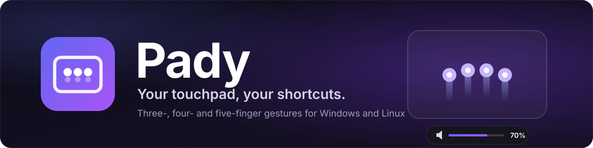
</p>

<p align="center">
  <a href="https://github.com/lumidren/Pady/releases/latest"></a>
  <a href="https://github.com/lumidren/Pady/releases"></a>
  <a href="https://github.com/lumidren/Pady/actions/workflows/ci.yml"></a>
  
  
  
  <a href="LICENSE"></a>
</p>

<p align="center">
  <b>Your touchpad, finally awake.</b><br>
  Three-finger drag, plus 32 more gestures you can point at anything:<br>
  volume, brightness, media keys, shortcuts, apps, links. Per app, if you're picky.<br>
  Free and open source · Windows &amp; Linux · written in Rust · about 20 MB in the tray.
</p>

<p align="center">
  <a href="https://github.com/lumidren/Pady/releases/latest"><b>Download for Windows or Linux</b></a> ·
  <a href="https://lumidren.github.io/Pady/">Website &amp; live demo</a> ·
  <a href="https://www.youtube.com/watch?v=e4grMSxty78">Video</a> ·
  <a href="#quick-start">Quick start</a> ·
  <a href="#faq">FAQ</a> ·
  <a href="#how-it-works">How it works</a>
</p>

<p align="center">
  <a href="https://www.youtube.com/watch?v=e4grMSxty78">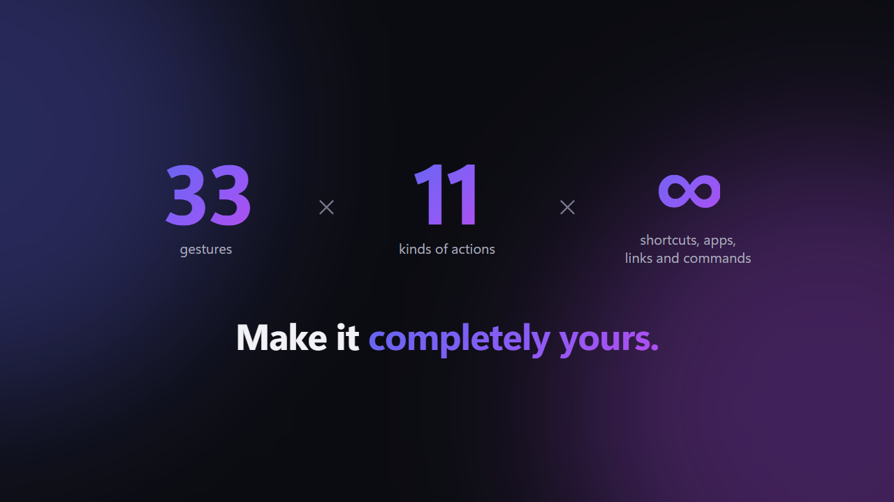</a><br>
  <sub>Pady in 60 seconds (YouTube)</sub>
</p>

## Why Pady

- **More gestures than your OS gives you.** Tap, double tap, triple tap, hold, swipe in four directions, pinch in or out, and drag, each with 3, 4 or 5 fingers. That's 33 gestures you can bind.
- **Copy and paste with one hand.** Pinch three fingers together to copy, spread them to paste. A glowing "Copied" or "Pasted" notice confirms it.
- **Three-finger drag on Windows.** Move windows and select text without pressing the touchpad, like on a Mac.
- **Scrub, don't spam.** Keep sliding and volume, brightness or zoom keeps stepping. Volume and brightness glide in small steps, like a slider under your fingers.
- **Per-app profiles.** Swipes can switch browser tabs in Chrome and desktops everywhere else. Pady detects the app for you.
- **Feedback you can see.** A small pill in the corner says what happened: "Copied", "Pasted", a track skipped. Moving effects like the swipe glow are there if you want them.
- **Beginner friendly.** A first-run tutorial checks your touchpad, turns off clashing OS gestures, offers starter presets and lets you practise.
- **Keeps itself up to date.** A new version is one click away, from the tray or the app, and only installs if it carries Pady's update signature.
- **Light and private.** One small Rust process in the tray, no CPU while idle, no telemetry, no accounts, no ads.

## What's in each version

| | Feature | Where it is |
|---|---|---|
| ✅ | 33 gestures, a dozen kinds of action, per-app profiles, five starter presets, three-finger drag | **v1.0.0** (released 2026-10-29) |
| ✅ | Copy and paste with a three-finger pinch, corner notices, swipe glow, show touches | **v1.0.0** |
| ✅ | Auto-update, first-run tutorial, `pady-cli`, Linux packages that set up touchpad access | **v1.0.0** |
| 🔜 | **Switch keyboard language** as an action, with the language named in a corner notice | Next update (on `main`) |
| 🔜 | **Calmer defaults**: corner notices on, moving animations off, and a separate Notices section in Settings | Next update (on `main`) |
| 🔜 | **Config backups**: a copy before every change, and **Restore** in Settings | Next update (on `main`) |
| 🔜 | **Beta builds** for trying new things early (they never update themselves) | Next update (on `main`) |
| 🧪 | **Glyphs**: draw your own two-finger shapes (a circle, a V, a check mark) and bind them like any gesture | Coming soon. Built, but shown only in beta builds for now |
| 🧪 | **Translator**: select text, do a gesture, and a pop-up shows the translation (free MyMemory or DeepL, 38 languages) | Coming soon. Being built on the `translator` branch |

The full history is in [CHANGELOG.md](CHANGELOG.md).

## Videos

| Pady in 60 seconds | Copy and paste with a pinch |
|---|---|
| <a href="https://www.youtube.com/watch?v=e4grMSxty78"></a> | <a href="https://www.youtube.com/watch?v=aciO9Ana1ZE">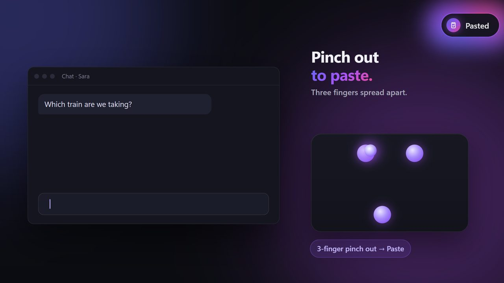</a> |
| **Glyphs (coming soon)** | **Translator (coming soon)** |
| <a href="https://www.youtube.com/watch?v=Cz4-n7IDi_s">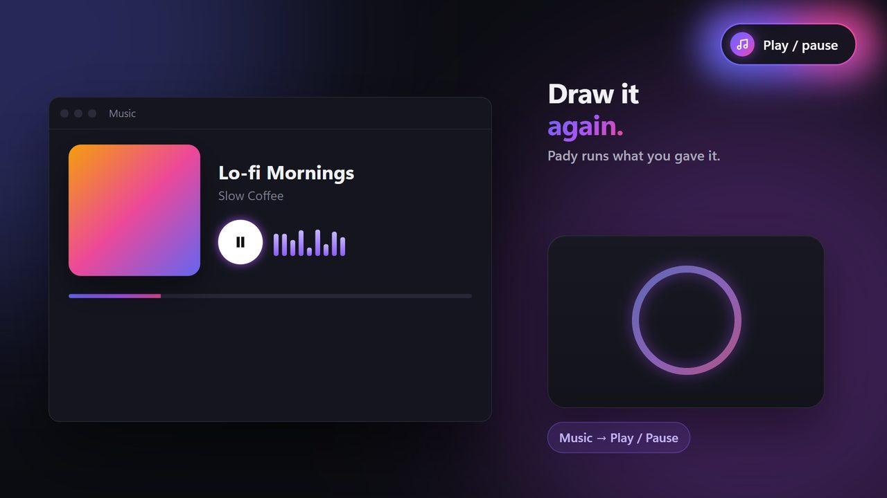</a> | <a href="https://www.youtube.com/watch?v=sNIkzMRkDb4">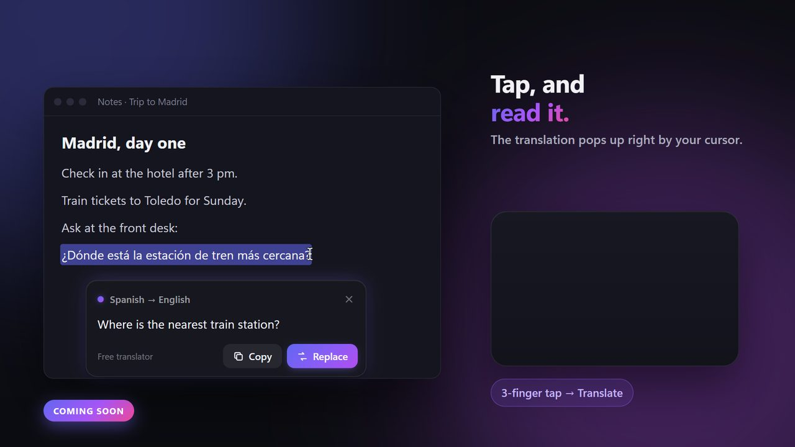</a> |

<p align="center">
  
</p>

## Screenshots

| Gestures | Per-app profiles |
|---|---|
| 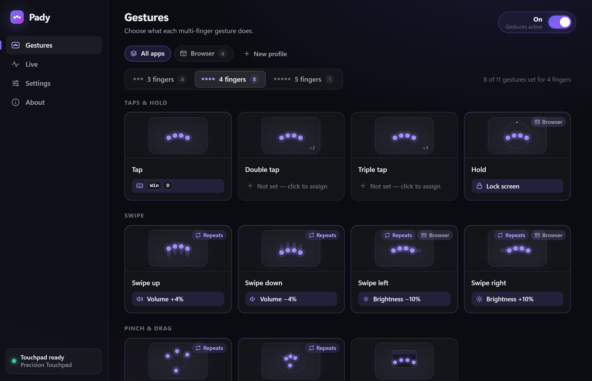 | 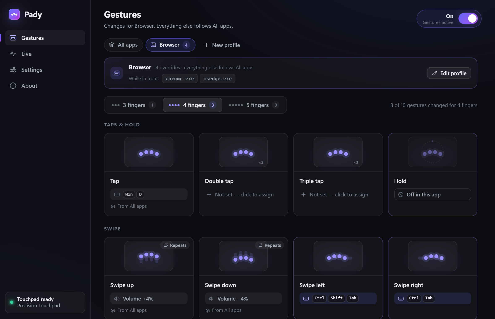 |
| **Live view** | **Guided setup** |
| 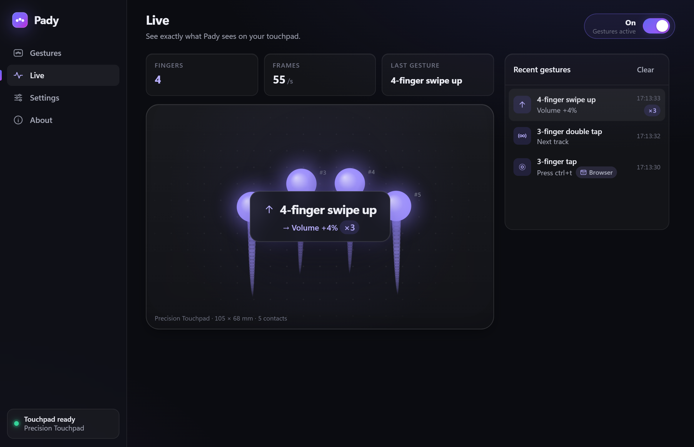 | 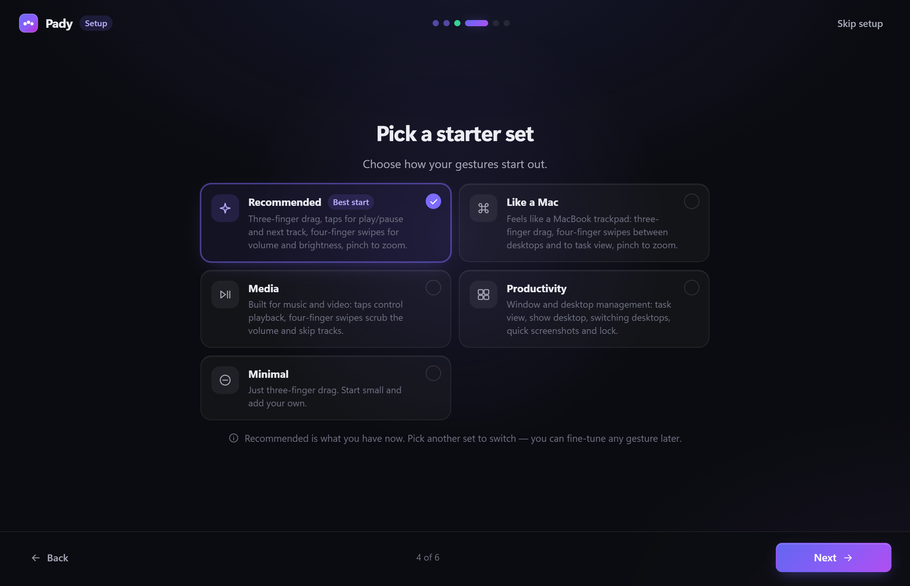 |
| **Settings** | **Level overlay** |
| 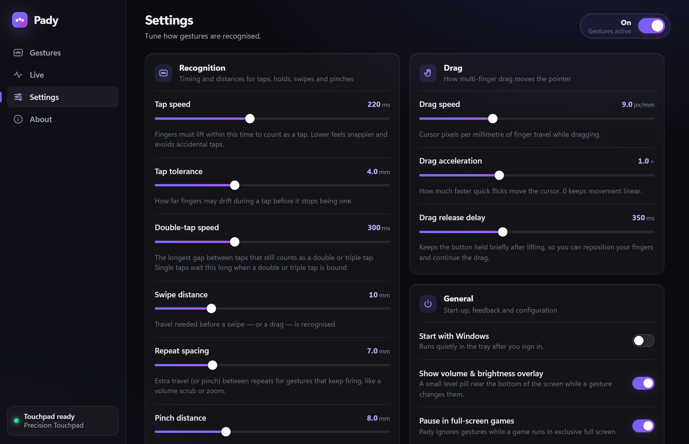 | 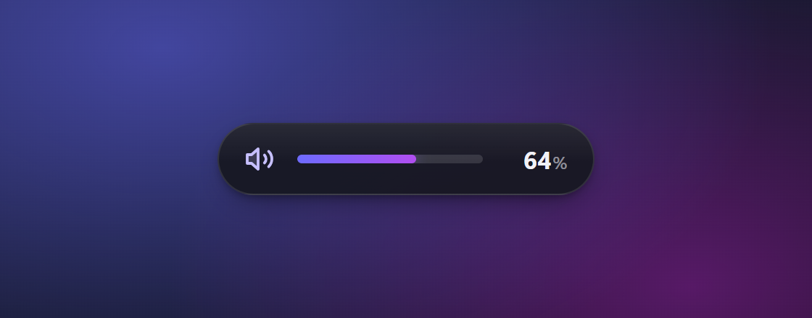 |

## Install

Download from the [latest release](https://github.com/lumidren/Pady/releases/latest). Sizes are for v1.0.0.

| System | File | Size | What happens |
|---|---|---|---|
| **Windows 10 / 11** | `Pady_<version>_x64-setup.exe` | 5.6 MB | Installs for you only, with no admin prompt, and adds Pady to the Start menu. If Microsoft WebView2 is missing, the installer downloads it. Nothing else is needed. |
| Windows (managed PCs) | `Pady_<version>_x64_en-US.msi` | 7.3 MB | Per-machine install for Intune or Group Policy. |
| **Ubuntu, Debian, Mint** | `Pady_<version>_amd64.deb` | 5.4 MB | `sudo apt install ./Pady_*_amd64.deb` pulls in every dependency and sets up touchpad access. |
| **Fedora, openSUSE** | `Pady-<version>-1.x86_64.rpm` | 5.4 MB | `sudo dnf install ./Pady-*.x86_64.rpm`, same as the .deb. |
| Any Linux | `Pady_<version>_amd64.AppImage` | 84 MB | `chmod +x` it and run. The tutorial's **Fix permissions** button sets up access and installs missing helper tools after one password prompt. |
| Terminal tool only | `pady-cli-<version>-windows-x64.zip` or `-linux-x64.tar.gz` | about 1 MB | The optional [`pady-cli`](#command-line). |

Every release also lists SHA-256 checksums for every file (`SHA256SUMS-windows.txt`, `SHA256SUMS-linux.txt`).

> [!WARNING]
> **Windows: turn off Windows' own touchpad gestures first**, or Windows and Pady will both react to the same swipe. Open **Settings › Bluetooth & devices › Touchpad**, then under **Three-finger gestures** and **Four-finger gestures** set **Swipes** and **Taps** to **Nothing**. Pady's first-run setup walks you through it.

> [!NOTE]
> The Windows installer is not code-signed yet (see the [code signing policy](#code-signing-policy)), so Windows may show *"Windows protected your PC"*. Click **More info › Run anyway**. You can compare the file with the published SHA-256 checksum first.

**Uninstalling** works like any other app (Settings › Apps on Windows, your package manager on Linux). It also removes Pady from start-up, and can remove your settings.

## Quick start

1. **Install and open Pady.** The tutorial starts by itself.
2. **Let it check your touchpad.** On Windows it shows how to switch off the OS's own three- and four-finger gestures, so the two don't fight. On Linux it offers **Fix permissions** if needed.
3. **Pick a starter preset**: Recommended, Like a Mac, Media, Productivity or Minimal.
4. **Practise.** The tutorial ticks off each gesture as you do it.

Then change anything: click a card on the **Gestures** page and choose what it does, or press **Test** to try an action without the gesture. Pady lives in the tray and starts with your computer, so your gestures are always there. You can turn that off in Settings. To pause every gesture for a while, untick **Gestures on** in the tray menu.

## Gestures

Every gesture works with 3, 4 or 5 fingers. One and two fingers stay with your OS for pointing and scrolling.

| Gesture | Config name | How to do it |
|---|---|---|
| Tap | `tap:N` | Touch and lift within 220 ms, without moving more than 4 mm. |
| Double tap | `doubletap:N` | Two taps, the second starting within 300 ms of the first lift. |
| Triple tap | `tripletap:N` | Three taps in a row. |
| Hold | `hold:N` | Rest the fingers without moving for 600 ms. |
| Swipe | `swipe:N:up` · `down` · `left` · `right` | Slide 10 mm. With **repeat** it keeps firing every 7 mm as you keep sliding. |
| Pinch | `pinch:N:in` · `out` | Close or open your hand by 8 mm. With **repeat** it keeps stepping as you keep pinching. |
| Drag | `drag:N` | Slide, and Pady holds the left mouse button while the fingers move. Lift and put them back within 350 ms to keep dragging. |

The numbers are the defaults; you can change all of them in Settings.

**33 gestures:** 3 finger counts × 11 (tap, double tap, triple tap, hold, 4 swipes, 2 pinches, drag).

A few rules keep them apart:

- **Taps only wait when they have to.** If no double or triple tap is bound for that finger count, a tap fires the moment you lift. If one is bound, a single tap waits up to 300 ms to see whether another follows.
- **Drag takes over swipes.** When `drag:3` is on, three fingers moving always drag, so three-finger swipes are not used. The app marks those cards.
- **Pinches are only looked for when one is bound.** Then a hand that closes or opens more than it slides is a pinch, whatever its angle. Otherwise a sloppy swipe can never turn into a pinch.

## Actions

| Action | What it does | In the config file |
|---|---|---|
| Keyboard shortcut | Any combo, e.g. `ctrl+shift+t`, `win+d`, `alt+f4`. Record it straight from your keyboard. | `{ type = "keys", combo = "ctrl+shift+t" }` |
| Volume up / down | Exact steps on the default output device. On Windows, Windows shows its own volume slider. | `{ type = "volume", step = 4 }` |
| Mute | Toggles mute on the default output device. | `{ type = "mute" }` |
| Brightness up / down | Laptop screens (WMI on Windows; brightnessctl, sysfs or logind on Linux) and external monitors (DDC/CI). | `{ type = "brightness", step = 10 }` |
| Media keys | Play/pause, next, previous, stop, and the volume keys. | `{ type = "media", key = "play_pause" }` |
| Open a link | In your default browser or a specific one (Chrome, Edge, Firefox, Brave). | `{ type = "open_url", url = "https://…", browser = "chrome" }` |
| Launch an app | A program, path or URI such as `ms-settings:`. Browse for it, or type its name as it appears in Start. | `{ type = "launch", program = "notepad.exe" }` |
| Switch to an app | Brings it to the front, minimises it if it's already in front, and launches it if it isn't running. | `{ type = "focus_or_launch", program = "chrome.exe" }` |
| Run a command | Anything your shell can run (`cmd /C` on Windows, `sh -c` on Linux). | `{ type = "run", command = "…" }` |
| Lock the screen | Locks your session. | `{ type = "lock" }` |
| Drag | Three-finger drag style: holds the left button while the fingers move. For drag gestures. | `{ type = "drag" }` |
| Switch keyboard language *(next update)* | Presses Win+Space, and a corner notice names the language, like "Arabic" or "English". | `{ type = "keys", combo = "win+space" }` |
| Nothing | Switches a gesture off, for example inside one app. | `{ type = "none" }` |

The gesture editor also has one-click choices for common jobs: zoom in and out, show desktop, task view (overview on Linux), next and previous desktop, screenshot, close window, open Chrome, open YouTube. They are shortcuts or actions from the table, picked to suit Windows or Linux.

## Starter presets

Pick one in the tutorial or in Settings, or run `pady-cli config preset <id>`. A preset replaces the **All apps** gestures; your per-app profiles stay. A new install starts with **Recommended**.

| Gesture | Recommended | Like a Mac | Media | Productivity | Minimal |
|---|---|---|---|---|---|
| 3-finger drag | Drag | Drag | Drag | Drag | Drag |
| 3-finger tap | Play / pause | Play / pause | Play / pause | Play / pause | |
| 3-finger double tap | Next track | | Next track | | |
| 3-finger triple tap | | | Previous track | | |
| 3-finger pinch in / out | Copy / paste | Copy / paste | | Copy / paste | |
| 4-finger swipe up / down | Volume up / down (repeats) | Task view / show desktop | Volume up / down (repeats) | Task view / show desktop | |
| 4-finger swipe left / right | Brightness down / up (repeats) | Next / previous desktop | Previous / next track | Next / previous desktop | |
| 4-finger tap | Show desktop | | Mute | Screenshot | |
| 4-finger hold | Lock | | | Lock | |
| 4-finger pinch out / in | Zoom in / out (repeats) | Zoom in / out (repeats) | | Zoom in / out (repeats) | |

Shortcuts follow your OS. On Windows, task view is `win+tab`, desktops are `win+ctrl+left/right` and a screenshot is `win+shift+s`. On Linux they are `win` (overview), `win+pageup/pagedown` and `printscreen`. Like on a Mac, fingers moving left bring in the desktop on the right.

Preset ids are `recommended`, `macos`, `media`, `productivity` and `minimal`; `pady-cli presets` lists them.

## Per-app profiles

A profile changes some gestures while specific apps are in front; everything else follows **All apps**. In the app, click **New profile** and use **Detect app**: switch to the app and Pady records its name. A gesture can also be switched off in an app.

App names are matched loosely: `C:\Apps\Code.EXE`, `code.exe` and `Code` are the same app. `pady-cli app` prints the name of each app as you switch to it.

```toml
[[profile]]
name = "Browser"
apps = ["chrome.exe", "msedge.exe", "firefox"]

[[profile.binding]]
trigger = "swipe:4:left"
action = { type = "keys", combo = "ctrl+shift+tab" }   # previous tab

[[profile.binding]]
trigger = "swipe:4:right"
action = { type = "keys", combo = "ctrl+tab" }         # next tab

[[profile.binding]]
trigger = "tap:4"
action = { type = "none" }                             # off in the browser
```

## Notices and animations

On Windows, Pady draws its own small notices. They never take focus or clicks.

| Notice or effect | Default | What it shows |
|---|---|---|
| Copied | On | A pill in the top-right corner when you copy in the app in front. Pady is told *that* you copied, never *what*. |
| Pasted, track changes, play/pause | On | Actions you couldn't otherwise see. |
| Pinch steps | On | Counts each zoom step while you pinch. |
| Gestures paused | On | Says when a gesture was skipped because a full-screen game is in front. |
| Keyboard language | On | Names the language when you switch it. |
| Screenshot | Off *(next update)* | The screenshot tool already shows itself. |
| Level pill | Off on Windows, on on Linux | The volume or brightness level while you scrub. Windows has its own volume slider. |
| Swipe glow | Off | A soft glow at the screen edge a swipe is heading for, flashing when it fires. |
| Gesture hints | Off | Names each gesture and what it did, while you learn. |
| Show touches | Off | Glowing fingertips on a small touchpad in the corner, for recording tutorials. |
| Previews, live touchpad, celebrations | Off | Animations inside the Pady window. |

These are the calmer defaults of the next update. In v1.0.0 the notices and the moving animations share one **Animations** switch. Glow, glow strength, animation speed and how long notices stay can all be adjusted, and a new default never changes a setting you've already saved.

## Configuration

Everything you set in the window is saved to a readable TOML file. Edit it by hand if you like: Pady notices the change within about two seconds and applies it, with no restart. If the file can't be read, Pady keeps it as `config.broken.toml` and starts with the defaults.

| System | Config file | Logs |
|---|---|---|
| Windows | `%APPDATA%\Pady\config.toml` | `%LOCALAPPDATA%\com.lumidren.pady\logs` |
| Linux | `~/.config/pady/config.toml` | `~/.local/share/com.lumidren.pady/logs` |

`pady-cli config path` prints the location, and **Settings** has a button that opens the folder. Logs are rotated at 1 MB and hold gestures and errors, never what you type.

<details>
<summary><b>An example config</b></summary>

```toml
[settings]
enabled = true
tap_max_ms = 220
swipe_threshold_mm = 10.0
swipe_step_mm = 7.0
hold_ms = 600
pause_in_fullscreen = true
check_updates = true

# All apps
[[binding]]
trigger = "drag:3"
action = { type = "drag" }

[[binding]]
trigger = "tap:3"
action = { type = "media", key = "play_pause" }

[[binding]]
trigger = "swipe:4:up"
action = { type = "volume", step = 4 }
repeat = true                  # keep stepping while the fingers keep sliding

[[binding]]
trigger = "pinch:3:in"
action = { type = "keys", combo = "ctrl+c" }

[[binding]]
trigger = "hold:5"
action = { type = "open_url", url = "https://github.com/lumidren/Pady", browser = "firefox" }

# Only while VS Code is in front
[[profile]]
name = "Code"
apps = ["code"]

[[profile.binding]]
trigger = "swipe:4:left"
action = { type = "keys", combo = "ctrl+pageup" }
```

Settings you leave out take their defaults, and a later binding for the same trigger replaces an earlier one. The top of the file Pady writes lists every trigger and action.
</details>

### Settings

All distances are millimetres on the touchpad surface, so they feel the same on every laptop. Hand-edited values are kept within a workable range.

| Setting | Default | Meaning |
|---|---|---|
| `enabled` | true | Master switch. When off, Pady watches but never acts. |
| `tap_max_ms` | 220 | A tap must lift within this many milliseconds… |
| `tap_slop_mm` | 4 | …and no finger may wander further than this. |
| `multi_tap_ms` | 300 | Longest gap between the taps of a double or triple tap. |
| `hold_ms` | 600 | Resting this long without moving counts as a hold. |
| `swipe_threshold_mm` | 10 | Travel before a swipe or drag starts. |
| `swipe_step_mm` | 7 | Spacing between repeats while sliding. Volume and brightness swipes glide 3.5 times as often, in 2% steps. Pinches step every 14 mm of hand span. |
| `pinch_threshold_mm` | 8 | Change in hand span before a pinch starts. |
| `drag_speed` | 9 | Cursor pixels per millimetre while dragging. |
| `drag_acceleration` | 1 | How much faster quick flicks move the cursor (0 = linear). |
| `drag_release_ms` | 350 | Lift and re-place within this to keep dragging (0 = let go at once). |
| `show_overlay` | false on Windows, true on Linux | The level pill for volume and brightness. |
| `pause_in_fullscreen` | true | Ignore gestures while a game runs in exclusive full screen (Windows). |
| `show_copy_notice` | true | The "Copied" notice (Windows). |
| `check_updates` | true | Look for a new version on GitHub twice a day. |

The animation and notice switches (`animations`, `anim_*`, `glow_strength`, `anim_speed`, `notice_time`) are easiest to set in **Settings**.

### Backups

*Next update.* Before Pady changes your config, it keeps a copy in a `backups` folder next to it (`config-<time>.toml`), so a slip in the app, a bad import or a broken update can always be undone. **Settings › Backups** lists the copies with how many gestures, profiles and glyphs each holds, and **Restore** brings one back. The current config is copied first, so a restore can itself be undone.

- One copy each time Pady starts, and before every save.
- Identical copies are skipped. While you're busy changing things, only the state from before the burst is kept (at most one copy per two minutes), so a dozen toggles don't push real history out.
- Resetting, applying a preset and restoring always take a copy.
- The newest 50 copies are kept.

## Command line

`pady-cli` is a small terminal companion. It's a separate download on the release page, or build it with `cargo build --release -p pady-cli`.

```text
pady-cli doctor                Check config, touchpad, clashing OS gestures and permissions
pady-cli devices               List detected touchpads
pady-cli monitor               Show fingers and recognised gestures live (no actions run)
pady-cli run                   Run Pady headless with your config (actions run)
pady-cli app                   Print the app in front as you switch (names for profiles)
pady-cli action <toml>         Run one action now: pady-cli action '{ type = "volume", step = 5 }'
pady-cli presets               List starter presets
pady-cli config [path]         Print where the config file is
pady-cli config show           Print the config
pady-cli config reset          Go back to the defaults
pady-cli config preset <id>    Apply a preset
pady-cli fix-permissions       Linux: install the udev rule and helper tools Pady needs
```

Set `RUST_LOG=debug` for more detail.

## FAQ

<details>
<summary><b>Windows still switches apps when I swipe with three fingers</b></summary>

Windows runs its own touchpad gestures alongside Pady, and apps can read touchpad input but not block it. Open **Settings › Bluetooth & devices › Touchpad › Three-finger gestures** (and four-finger) and set *Swipes* and *Taps* to **Nothing**. Pady shows a banner with a button to that page whenever this is needed. Five-finger gestures never clash.
</details>

<details>
<summary><b>Nothing happens on Linux</b></summary>

Run `pady-cli doctor`. If Pady can't read the touchpad or send keys, click **Fix permissions** in the app or run `pady-cli fix-permissions`. The .deb and .rpm packages do this when installed. GNOME uses three-finger swipes and KDE uses four-finger swipes for their own gestures, so pick other finger counts or turn theirs off.
</details>

<details>
<summary><b>Does it work on Wayland?</b></summary>

Gestures and all actions work. Switching to an app and per-app profiles need to know which window is in front. That works for X11 and XWayland apps, and on KDE Plasma with `kdotool`; on other Wayland desktops those two features fall back gracefully.
</details>

<details>
<summary><b>Which touchpads are supported?</b></summary>

On Windows, any **Precision Touchpad**, which covers most laptops from the last several years. On Linux, any multitouch touchpad the kernel exposes through evdev, including ones that report fewer finger slots than fingers.
</details>

<details>
<summary><b>How much memory does it use?</b></summary>

With the window closed, Pady runs without any web view: one process using about 20–40 MB (under 8 MB of it private), and no CPU time at all while you aren't touching the pad. Opening the window starts WebView2, which takes a few hundred MB more until you close the window again. Measured on Windows 11 with Pady 0.3.0.
</details>

<details>
<summary><b>Where are the logs?</b></summary>

Windows: `%LOCALAPPDATA%\com.lumidren.pady\logs`. Linux: `~/.local/share/com.lumidren.pady/logs`. They hold gestures and errors, never what you type.
</details>

## How it works

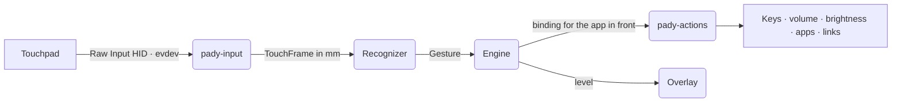

- **Real finger data.** Pady reads each finger's position from the touchpad, converted to millimetres, so thresholds feel the same on every laptop.
- **A tested recognizer.** It measures movement only from fingers present in consecutive frames, so fingers landing or lifting never look like a jump. About 160 unit tests cover taps, multi-taps, holds, swipes, pinches and drags, the config format, the Linux multitouch decoder and the overlay, and fuzz tests throw random device reports, configs and frames at every parser.
- **Actions never block touch.** Recognition and actions run on separate threads. The engine sleeps until the next frame or the next timer that's due.

| Crate | Purpose |
|---|---|
| `pady-core` | Recognizer, config, presets and engine. Platform-independent and fully unit-tested. |
| `pady-input` | Windows Raw Input and Linux evdev touchpad backends. |
| `pady-actions` | Keys, audio, brightness, apps, autostart and permissions per OS. |
| `pady-overlay` | The native Windows level overlay (no web view). |
| `pady-cli` | The terminal tool. |
| `pady-app` | The Tauri desktop app and its UI. |

## Build from source

You need [Rust](https://rustup.rs) 1.82+.

- **Windows:** Visual Studio Build Tools (*Desktop development with C++*).
- **Linux:** `sudo apt install libwebkit2gtk-4.1-dev libayatana-appindicator3-dev librsvg2-dev libxdo-dev libssl-dev`

```bash
git clone https://github.com/lumidren/Pady
cd Pady
cargo run -p pady-app --release
```

To build the installers yourself, run this in `crates/pady-app`: `npx @tauri-apps/cli@2 build` (add `--bundles nsis,msi` on Windows, or `deb,rpm,appimage` on Linux). [RELEASING.md](RELEASING.md) covers releases and code signing; [CONTRIBUTING.md](CONTRIBUTING.md) covers development, including the UI preview that runs without the backend.

Ideas welcome! Open an [issue](https://github.com/lumidren/Pady/issues/new/choose).

## Code signing policy

Windows releases are signed so you can check they come from this project. Free code signing provided by [SignPath.io](https://about.signpath.io), certificate by [SignPath Foundation](https://signpath.org).

- **Committers and reviewers:** [lumidren](https://github.com/lumidren)
- **Approvers:** [lumidren](https://github.com/lumidren)

Only what is built from this repository by the [Release workflow](.github/workflows/release.yml) on GitHub Actions is signed: the workflow builds the installers from a version tag, sends them to SignPath, and attaches the signed files with SHA-256 checksums to a draft release that the maintainer publishes. Every signing request is approved by hand. Changes from other contributors are reviewed before they are merged. The maintainer's GitHub and SignPath accounts use multi-factor authentication.

### Privacy

Pady will not transfer any information to other networked systems unless specifically requested by the user or the person installing or operating it, with one exception you can turn off: twice a day it asks GitHub whether a newer version exists (`github.com/lumidren/Pady/releases/latest/download/latest.json`). That request carries no information about you or your PC beyond what any web request does, and you can switch it off under **Settings › Check for updates**. Pady has no accounts, no ads and no telemetry, reads only the touchpad, and never reads what you copy.

## Made by

**lumidren**, designed, coded and shipped solo, because the Mac trackpad shouldn't get to have all the fun.

[LinkedIn](https://www.linkedin.com/in/lumidren) · [GitHub](https://github.com/lumidren) · [Website](https://lumidren.github.io/Pady/)

## License

Pady is open source under the [MIT license](LICENSE).
