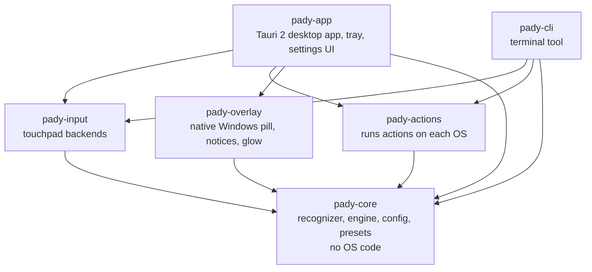
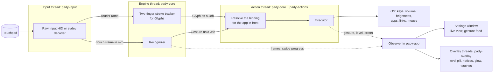
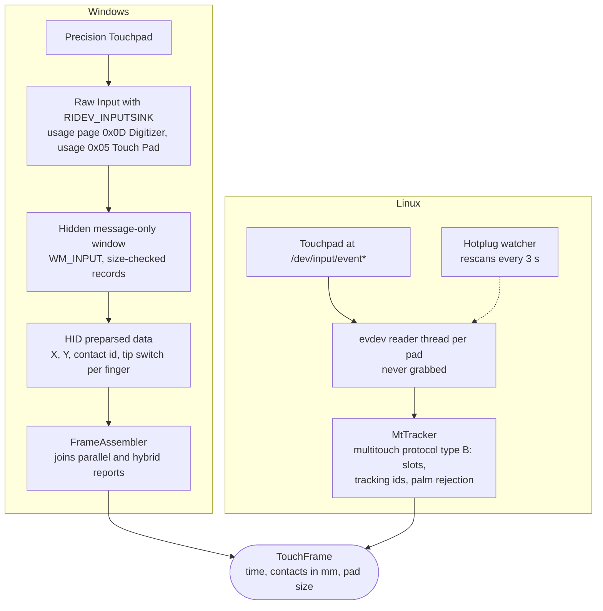
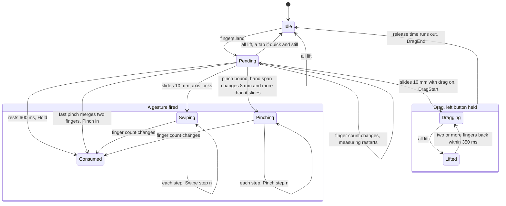
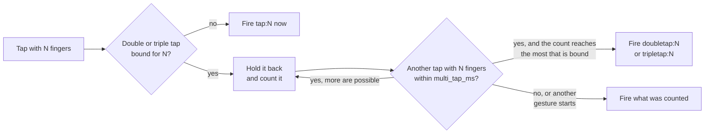
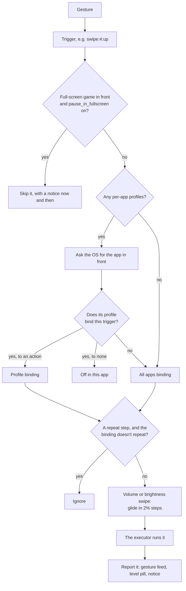
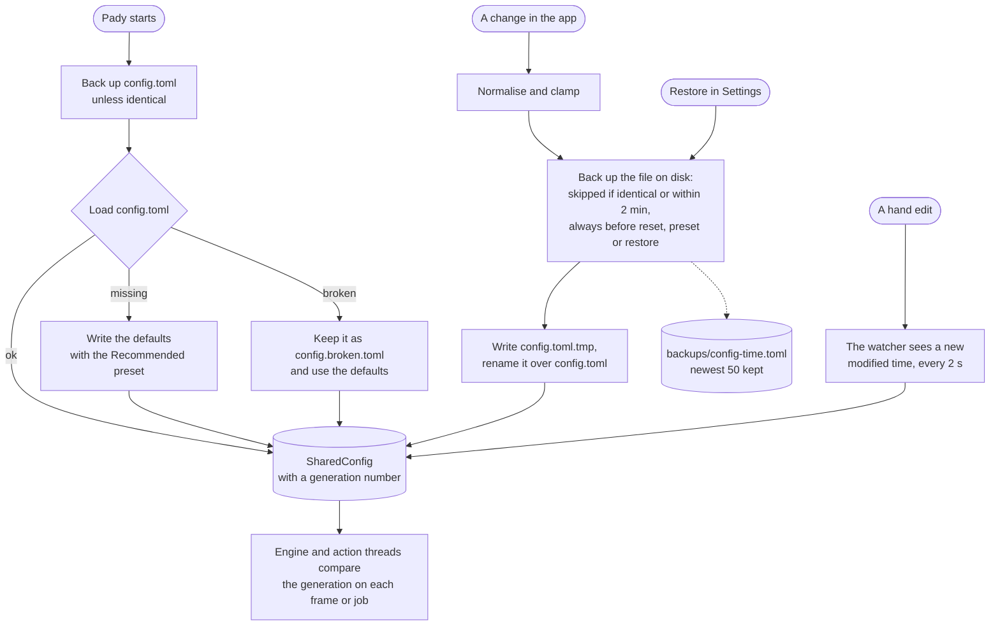
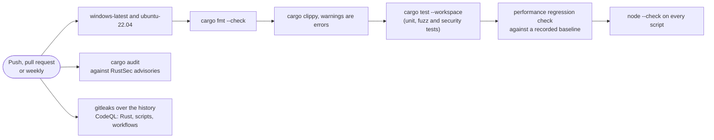
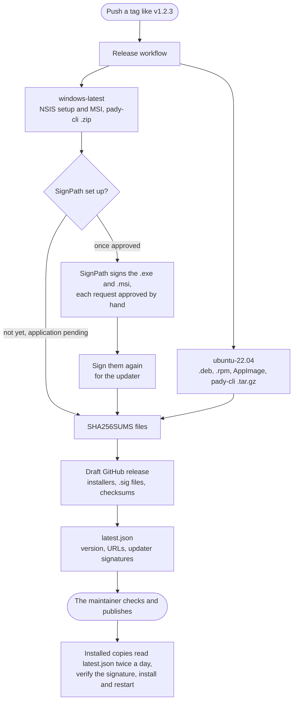

# How it works

## Architecture

Pady is a Cargo workspace of six crates. The gesture logic in `pady-core` has no OS code at all, so it's tested the same way on every platform. Everything OS-specific sits around it.



| Crate | Purpose | Main modules |
|---|---|---|
| `pady-core` | Turns touch frames into gestures and gestures into jobs. Config, presets, backups. Platform-independent and fully unit-tested. | `recognizer`, `engine`, `config`, `trigger`, `gesture`, `action`, `presets`, `backups`, `glyphs`, `keys` |
| `pady-input` | Touchpad backends: Windows Raw Input and Linux evdev. Thread priority and timer precision. | `windows`, `hid`, `linux`, `mt`, `sched` |
| `pady-actions` | Keys, audio, brightness, apps, links, lock, autostart, permissions and OS-gesture conflict checks. | `windows`, `linux` |
| `pady-overlay` | Native Windows layered windows drawn with GDI+: the level pill, corner notices, swipe glow and touches. | `windows`, `toast`, `fx`, `glow`, `anim`, `notice`, `layout`, `shadow` |
| `pady-app` | The Tauri app: tray, commands, watchdog, updater. The UI is plain HTML/CSS/JS with no build step. | `main`, `update`, `feedback`, `responsive`, `ui/` |
| `pady-cli` | `doctor`, `monitor`, `run` and the rest. | `main` |

## Threads and data flow

Data flows one way. Each stage runs on its own thread and hands over through channels, so a slow action never delays touch handling.



- The **engine thread** sleeps until a frame arrives or the next timer (hold, double tap, drag release) is due. With nothing pending it never wakes up.
- The **action thread** owns the OS handles (COM on Windows) and runs jobs in order.
- The **observer** passes events to the settings window (only while it's open, at most about 60 frames a second) and to the native overlay threads, which sleep while nothing is on screen.
- A **watchdog** in the app checks the touchpad listener every two seconds. It starts a fresh one after sleep, if the old one stopped, or if no touch arrived for a long time while the computer was in use. The same loop picks up hand edits to the config file.

## Touchpad input

Both backends only listen. They never grab the device, so the OS keeps pointing, clicking and scrolling. Every finger is reported in millimetres from the pad's top-left corner.



- **Windows.** Registering with `RIDEV_INPUTSINK` means reports arrive even while another app has focus. Some pads have fewer finger slots than fingers they can sense and split a frame over several reports ("hybrid" mode); the assembler puts it back together.
- **Linux.** The kernel only sends what changed, so the tracker remembers each slot's last state and yields a frame whenever a packet changes the contacts. Contacts the kernel marks as a palm are left out.
- **Scheduling.** On Windows the input, engine and action threads run at the highest normal priority. Pady asks for 1 ms timers only while a hold, double tap or drag release is pending, so idle battery use is unchanged. On Linux timers are already precise.

## Gesture recognition

A *session* lasts from the first finger landing until the last one lifts. Within it the [recognizer](../crates/pady-core/src/recognizer.rs) is in one phase at a time. Movement and spread are measured only from fingers present in consecutive frames, so a finger landing or lifting never looks like a jump. A finger at an impossible position is ignored, as if it had briefly lifted.



- **Pending** is where every decision is made. Swipes, pinches, drags and holds fire as soon as they're recognised. A **tap** is decided when the fingers lift: they lifted within `tap_max_ms`, no finger wandered more than `tap_slop_mm`, and nothing else fired. A tap counts the most fingers that were down.
- **Pinch or swipe?** A pinch is judged by the hand's *span* (the two fingers furthest apart), which moves by the full distance even when only the thumb does the pinching. In a close call, the recognizer waits until the hand has clearly travelled (1.5 × the swipe threshold) before calling it a swipe.
- **Swiping** stays on the axis it started on. With repeat, each further `swipe_step_mm` (a 3.5th of it for volume and brightness) fires another step. Pinches step every 2 × `swipe_step_mm` of span change. One frame can only produce a few steps, so a driver glitch can't flood the system with actions.
- **Dragging** keeps the button held for `drag_release_ms` after the fingers lift, so you can re-place them and carry on. A single finger coming back ends the drag at once, since that's ordinary pointing.
- **Fewer than 3 fingers** never fire anything, so pointing and scrolling stay with the OS.

Double and triple taps are counted across sessions:



## From gesture to action

The engine thread turns each gesture into a trigger such as `swipe:4:up` and sends it to the action thread, which decides what runs.



Each OS has its own executor:

| | Windows | Linux |
|---|---|---|
| Keys, media keys, mouse | `SendInput` | A `/dev/uinput` virtual device (X11 and Wayland alike), with `playerctl` as a media fallback |
| Volume | The volume keys, so Windows shows its own slider | `wpctl`, `pactl` or `amixer` |
| Brightness | WMI for laptop panels, DDC/CI for monitors | `brightnessctl`, sysfs backlight, logind, `ddcutil` |
| Apps and links | `ShellExecuteW`, which resolves App Paths; names are also found in the Start menu | `xdg-open`, or the program itself |
| App in front, switch to app | Win32 window APIs | `xdotool`, `xprop`, `wmctrl`, `kdotool` |

## Config, hot reload and backups



Writes are atomic (a temporary file, then a rename), so a crash never leaves half a config. The engine and action threads keep their own copy and only re-read it when the generation number changes, so nothing locks on each touch frame.

## Performance

| What | Number | Where it comes from |
|---|---|---|
| Memory in the tray | about 20 MB (21.7 MB working set, 4.8 MB private) | Measured on Windows 11 with the window closed |
| CPU while idle | 0% | No polling: every thread sleeps until a frame, a timer or a message arrives |
| Recognizing one touch frame | 23 ns (one finger pointing) to about 120 ns (swipes, pinches, drags), with no memory allocated while pointing or scrolling | `cargo bench -p pady-core` on a Windows 11 laptop. Touchpads send a frame every 7–8 ms. A test also keeps the 99th percentile under 100 µs on every CI run |
| Finger lift to action running | 56 µs median, about 200 µs at the 99th percentile | `cargo bench -p pady-core`, a five-finger tap through the engine to the action thread |
| Full-screen game check before each gesture (Windows) | about 0.1 ms; only the first gesture in a newly full-screen window waits for Windows' answer (17–90 ms) | `time_actions`; the shell's answer is reused and refreshed in the background |
| A volume step on Windows | well under 1 ms (about 13 ms before 0.3.2) | `cargo run -p pady-actions --release --example time_actions` |
| A brightness step on Windows | about 4.5 ms, the first one 8 ms (it connects to WMI at startup) | `time_actions` |
| Swipe glow and touches | about 0.2 ms of work per frame, paced by the display | The glow is drawn once; each frame only moves it and changes its opacity |
| Timers for holds, double taps, drag release | 1 ms precision while one is pending (Windows' default tick is ~15.6 ms) | Requested only while needed, then given back |
| Download | 5.7 MB Windows setup, 5.5 MB .deb | v1.0.0 release files |

Load, spike and soak results (the frame rate ramped to 500 touchpads' worth, a burst of half a million frames, 30 minutes of steady load) are in [docs/benchmarks.md](benchmarks.md).

To measure on your own machine:

```bash
cargo bench -p pady-core                                     # time and allocations per frame, gesture → action latency
cargo bench -p pady-security                                 # load ramp, overload point, profile lookup, config I/O, spike
cargo run -p pady-actions --release --example time_actions   # how long volume, mute and brightness take (changes are undone)
```

## Tests

About 266 unit tests across the workspace cover taps, multi-taps, holds, swipes, pinches, drags and glyphs, the config format and backups, the HID and Linux multitouch decoders, parsing Linux tool output, and the overlay's layout, motion and colours. Fuzz tests (named `fuzzed_*`) feed deterministic random device reports, multitouch events, configs, triggers, shortcuts and touch frames through every parser: nothing a device or a hand-edited file says may make Pady panic.

The 54 security tests in [`security/`](../security/README.md) are attacks: each one failed against the code before its fix (a program planted in the current folder, six threads saving the config at once, a process killed mid-save, a token in the log, a flood of volume steps) and must pass now. `cargo test -p pady-security` runs them alone.

CI runs on every push and pull request, on Windows and Ubuntu:



## Repository layout

```text
Pady/
├── Cargo.toml                 workspace: shared version and release profile
├── crates/
│   ├── pady-core/             recognizer, engine, config, presets, backups, glyphs
│   │   └── benches/           hot_path.rs: cost per frame, gesture → action latency
│   ├── pady-input/            windows.rs + hid.rs (Raw Input), linux.rs + mt.rs (evdev), sched.rs
│   ├── pady-actions/          windows.rs, linux.rs, apps.rs (installed apps), examples/
│   ├── pady-overlay/          native Windows pill, notices, glow and touches (GDI+)
│   ├── pady-cli/              the pady-cli tool
│   └── pady-app/              the Tauri app
│       ├── src/               main.rs (commands, tray, watchdog), update.rs, feedback.rs
│       ├── ui/                index.html, app.js, model.js, mock.js, styles.css, overlay.*
│       ├── capabilities/      which window may call which command
│       └── tauri.conf.json    bundles, CSP, updater public key
├── security/                  attack tests, load harness, threat model, assessment report
├── packaging/linux/           udev rule, modules-load file, .deb/.rpm scripts
├── site/                      the website, lumidren.github.io/Pady
├── scripts/                   website build, icons, README screenshots
├── docs/                      banner, demo, screenshots, video posters, benchmarks.md
└── .github/                   CI, security, release and website workflows, issue templates
```

## Release pipeline



Update files are signed with Pady's updater key, and the app only installs files signed with it. Windows installs and the AppImage update themselves; .deb and .rpm installs are told about new versions and update through the package manager. Beta builds never update themselves. [RELEASING.md](../RELEASING.md) has the details.

---

Back to the [README](../README.md).
